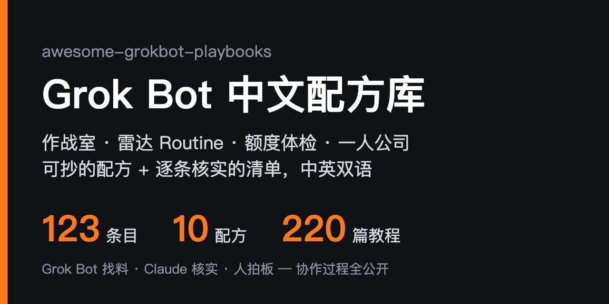

  

<h1 align="center">Awesome Grok Bot Playbooks</h1>

<b>Copy-paste Grok Bot recipes + a verified ecosystem list, Chinese-first</b>

  
  
  
  
  
  
  
  

  <a href="README.md">中文</a> · <b>English</b> · <a href="docs/quickstart.en.md">Quickstart</a> · <a href="ROADMAP.md">Roadmap</a> · <a href="#-contributing">Contributing</a>

## ⚡ Why this list

| | |
|---:|---|
| **123** | entries, each checked via the GitHub API or the live page: it exists, is still maintained and is actually about Grok Bot; license caveats are noted in the review |
| **10** | copy-paste recipes in one format: scenario → inputs → steps → prompt → output → pitfalls, all examples sanitized |
| **3 levels** | of verification: ✅ run end-to-end · 🔍 docs and config reviewed · no mark = repo verified only. ✅ is only for things actually run |
| **220** | curated community tutorials and X articles ([33 tutorials](docs/community-tutorials.md) + [187 articles from top X creators](docs/x-articles.md)) plus the maintainer's own series, each checked for liveness, author and date |
| **2 AIs** | maintain it: Grok Bot scouts daily, Claude Code verifies and writes reviews, a human makes the calls. The full log is public in [`.collab/`](.collab/README.md) |

Compared with the English ecosystem index [awesome-grok-bot](https://github.com/ZeroPointRepo/awesome-grok-bot), which is broad, this repo focuses on **solo founders, multi-bot war rooms, radar routines and copy-paste recipes**. Quality over quantity.

## 🤖 What is Grok Bot

Grok Bot is the AI-teammate product xAI and Cursor launched together on 2026-08-11 (beta). Each bot has a name and a role, and your bots share one always-on cloud computer with a browser, files and a terminal. You give them work, schedule **Routines**, teach them **Skills**, or import ready-made bots from the [marketplace](https://x.ai/bot/marketplace).

It is a different product from the Grok chat assistant and the Grok Build coding CLI.

## 🚀 3-minute start

> New to Grok Bot? Start with the **[Quickstart](docs/quickstart.en.md)**: 5 steps in one afternoon, from safety rules to a first Routine that doesn't burn your usage. The list below is the shortcut for people already up and running.

1. **Learn first**: read `AGENTS.md` and the failure log in [grokbot-field-notes](https://github.com/unicodef1wn/grokbot-field-notes)
2. **Want a ready-made team**: pick an `installable` team on [botteams](https://github.com/ellelion/botteams) and paste its installer prompt into Grok Bot
3. **Want to orchestrate yourself**: follow the [war room recipe](examples/war-room.md): split roles, hand off via files, add a human gate before publishing
4. **Want a ready-made template**: browse [Templates & directories](#-templates--directories), thousands of public share links sorted by role and quality
5. **Don't want the cloud**: see [Self-hosted bots](#-self-hosted-bots)

**Start with these 3 recipes** (written in Chinese)

| Recipe | What it solves | For |
|---|---|---|
| [Routine budget check](examples/routine-budget.md) | Usage running out: pause all, triage, re-enable one by one | People running many Routines |
| [War room](examples/war-room.md) | 3–6 bots hand off via files only, human gate before publishing | Anyone splitting work across bots |
| [X radar](examples/x-radar.md) | One daily pass over X, digest only real signals, silence otherwise | Content and go-global builders |

**Legend**: each entry = `[name](link) - review. Tags`; ✅ tested · 🔍 reviewed; "Recipe:" = written in this repo, "Template:" = one-click import into Grok Bot.

## 🆕 Recently added

- **10-26** Added six: drafts-only small-business [grok-bot-templates](https://github.com/ChamathRosh/grok-bot-templates); [claude-grok-bridge](https://github.com/francoCosimo95/claude-grok-bridge), so Claude Code and your bot can ask each other; a [Multica bridge](https://github.com/lthero-big/gbb-multica-bridge); [iMessage Relay](https://github.com/PhillipHolland/imessage-relay) for iMessage in X Chat; [Groknet](https://github.com/sudoTomas/groknet), where bots of different owners befriend each other; and [Botling](https://github.com/william1010121/Botling), a Grok Bot-style app on Claude Code and Codex; articles from top X creators grew to 187
- **10-25** Added three: the software-factory template [Firstmate](https://x.ai/bot/__4FfrkUdvpdMk6-LKg5r), where you only talk to one bot; the 358-page Chinese book [Grok Bot Blackbook](https://github.com/LJMStark/grok-bot-blackbook); and [GrokBotChineseFix](https://github.com/thinkingpower-labs/GrokBotChineseFix) for Chinese typing in the Windows app
- **10-25** Added two: [yobiru](https://github.com/chekusu/yobiru), which lets agents on your machines message each other and share a bot with friends, and one user's Grok Bot toolbox [my-bot-scripts](https://github.com/wustep/my-bot-scripts)

Full history: [README commits](https://github.com/sit-in/awesome-grokbot-playbooks/commits/main/README.md).

## 📚 Contents

- [Official & SDK](#-official--sdk) (5) - official docs, marketplace, SDKs and CLIs
- [Templates & directories](#-templates--directories) (12) - template libraries, bot-share indexes and use-case sites; check here first
- [Skills & Playbooks](#-skills--playbooks) (41) - skills, MCP, single templates, copy-paste profiles
- [Multi-bot teams](#-multi-bot-teams) (26) - war rooms, coordinators, multi-agent work
- [Routines & Digests](#-routines--digests) (7) - scheduled radars, weekly reviews, usage control
- [Chinese solo-founder](#-chinese-solo-founder) (5) - global support, WeChat, Chinese configs
- [Self-hosted bots](#-self-hosted-bots) (13) - stay off the cloud, bring your own model
- [Hardware](#-hardware) (4) - give your bot a physical front end
- [Learning](#-learning) (10) - tutorials, handbooks, tutorial indexes

---

## 🧰 Official & SDK

- [xAI API Docs](https://docs.x.ai) - Official API docs; source of truth for models, pricing and tool calling. Tags: `official` `api` `docs`
- [xai-org on GitHub](https://github.com/xai-org) - Official open-source org: SDKs and open model weights. Tags: `official` `sdk`
- [grokbot-sdk](https://github.com/adam91holt/grokbot-sdk) - Unofficial TypeScript SDK: talks to a running Grok Bot host's local gateway for roster, memories and transcripts, and reads the local data directory when the host is down. Needs the gateway token; keep it on your own machine. Tags: `sdk` `typescript` `unofficial`
- [grok-bot-cli](https://github.com/ScriptedAlchemy/grok-bot-cli) - Unofficial `gbot` CLI: create, update and delete bots and groups, send messages, pull threads, add or remove skills, and message a local Claude Code session. Reuses the Grok Bot desktop app's signed-in session, so no manual token copying; delete commands act on your whole account, so `list` first. Tags: `cli` `unofficial` `skills`
- [Grok Bot Marketplace](https://x.ai/bot/marketplace) - Official template catalog grouped by sales, engineering, marketing, design, operations and personal; click Add to import into your Grok Bot. Most single templates listed here can be found there. Tags: `official` `templates` `marketplace`

[⬆ Back to contents](#-contents)

## 📦 Templates & directories

- [UseGrokBot](https://usegrokbot.com/) - Third-party discovery site: templates grouped by role, real use cases, bot-team setups and ranked articles, in English, Chinese and Japanese. Browse it for ideas. Tags: `directory` `use-cases` `templates`
- [kydlikebtc/awesome-grokbot](https://github.com/kydlikebtc/awesome-grokbot) - Index of 4,600+ public x.ai/bot shares, link-checked daily with per-row attribution, plus a searchable site and a Chinese README. Catalog CC0, code MIT. Community shares vary in quality; review before importing. Tags: `awesome` `templates` `directory`
- [majiayu000/awesome-grok-bot](https://github.com/majiayu000/awesome-grok-bot) - About 4,800 x.ai/bot shares sorted into quality tiers, with a searchable site and bilingual README; "not a prompt dump". CC0. Tags: `awesome` `templates` `directory`
- [awesome-grokbot-templates](https://github.com/cs68614-hash/awesome-grokbot-templates) - Community template directory that lists only official x.ai/bot share links, never rehosted prompts, in several languages; the companion site grokbot-templates.com returned an error on 10/19, so use the repo. CC0. Tags: `awesome` `templates` `directory`
- [mergisi/awesome-grokbot](https://github.com/mergisi/awesome-grokbot) - 50+ copy-paste bot profiles and starter teams for sales, engineering, success, marketing and ops: send one link to a Setup bot and it builds the team. CC0. Tags: `profiles` `teams` `templates`
- [templatesgrokbot.com](https://github.com/templatesgrokbot/templatesgrokbot.com) - 3,000+ templates searchable by job title, MCP-accessible; uneven quality, use as an idea library. Tags: `templates` `catalog` `mcp`
- [botdirectory.ai](https://github.com/elie222/botdirectory.ai) - Open-source directory of bot prompts usable in Grok Bot, Rakazo and others; browse it for ideas. Tags: `templates` `directory` `prompts`
- [Useful Bots](https://usefulbots.pages.dev/) - Free Grok Bot templates for creators, grouped by video, growth, launch and more; a personal site we have not spot-checked one by one, so browse for ideas. Tags: `templates` `creators` `directory`
- [GrokBotDev](https://github.com/ZeroPointRepo/GrokBotDev) - Source of grokbot.dev, a directory run by its own bots: Scouts watch X for real setups, a Curator decides what gets in, a Builder maintains the site, and every change lands as a PR. Plugins, use cases and combos each get a page, plus a JSON API, RSS and MCP so your bot can subscribe on a schedule. Close in spirit to this repo's "AI scouts, a human decides" setup. Code MIT, content CC BY 4.0. Tags: `directory` `agent-run` `mcp`
- [GrokBot HQ](https://github.com/V-harshith/grokbothq) - Source of grokbothq.xyz: 4,200+ Grok bots by category, plus combos, guides and comparisons with Custom GPTs and others. The author says every listing is opened and tested by a human before publishing; we have not re-checked them. Code MIT, content CC BY 4.0. Tags: `directory` `combos` `guides`
- [Grok Bot Hub](https://github.com/ddhjy/grok-bot-hub) - An unofficial Chinese-language Grok Bot directory, live at ddhjy.github.io/grok-bot-hub: tutorials, templates and tools by section, each with a one-line Chinese note. Entries live in the repo's `catalog.json`, new ones come in by PR, and a validation script runs before each commit. Close in scope to this repo, so the two are worth browsing side by side. Code MIT, catalog data CC0. Tags: `directory` `chinese` `catalog`
- [grok-bot-templates](https://github.com/ChamathRosh/grok-bot-templates) - Six free templates for small businesses: quote follow-ups, missed-call replies, review replies, invoice reminders and a morning brief, plus a planner that asks five questions and picks your first bot. Drafts only: nothing is sent or paid for you, and missing details stay as `[FILL IN]` instead of being made up. Only the planner has a one-click install link so far; for the others, paste the instructions into an empty bot as its first message. The README links heavily to the author's site whatshouldmybotdo.com. MIT. Tags: `template` `small-business` `drafts-only`

[⬆ Back to contents](#-contents)

## 🧩 Skills & Playbooks

- [Recipe: Teach-a-Task](examples/teach-a-task.md) - Pairs with Grok Bot's built-in Teach a Task: set boundaries before the demo, turn it into a reviewable skill card after, dry-run before letting go. (Chinese) Tags: `example` `skill` `teach-a-task`
- [grok-bot-templates](https://github.com/cobusgreyling/grok-bot-templates) - Engineering kit for templates: spec, Bot Ready score, team / skill / routine catalog. Check its structure before writing your own. Tags: `templates` `spec` `routine`
- [botskills](https://github.com/PramodDutta/botskills) - Paste-ready bot setups; each declares the one action it never takes without you. Good guardrail pattern. Tags: `skills` `guardrails`
- [grokbot-for-gtm](https://github.com/bcharleson/grokbot-for-gtm) - Full outbound GTM motion from list building and enrichment to reply handling. Tags: `playbook` `gtm` `outbound`
- [grokbot-field-notes](https://github.com/unicodef1wn/grokbot-field-notes) - Unofficial notes from the xAI team's 72-hour live build: rules, 69 roles, 9 role playbooks and 40 failures; `AGENTS.md` is drop-in. Tags: `playbook` `field-notes` `agents-md`
- [grok-bot-jev](https://github.com/Bodila51/grok-bot-jev) - A cheap classification step before expensive research or retries; worth copying the idea. Depends on the third-party TypeSafe service. Tags: `skill` `cost` `decision-layer`
- [agent-cookie-sync](https://github.com/markfulton/agent-cookie-sync) - Hands your signed-in Chrome sessions to a cloud bot without pasting passwords; that still hands over account access, so use low-sensitivity accounts only. Tags: `chrome` `session` `security`
- [devspace](https://github.com/Waishnav/devspace) - Minimal coding-agent harness over MCP, giving Grok Bot, Claude, ChatGPT and others the ability to read and edit code. Tags: `mcp` `coding` `harness`
- [Bland phone MCP](https://docs.bland.ai/integrations/mcp/grok-bot) - Third-party official docs: connect Bland's MCP so Grok Bot can call and text from a dedicated number; the bot can pay for and open the account inside a conversation, so put a human gate in front of it. Tags: `mcp` `voice` `outbound`
- [grokbot-imessage-skill](https://github.com/jeffhuber/grokbot-imessage-skill) - Lets Grok Bot read, search and triage iMessage on macOS, with preview-and-confirm before sending. Requires Full Disk Access, which hands your whole message history to the bot; use with care. Tags: `skill` `imessage` `macos`
- [grok-bot-skill](https://github.com/adamanz/grok-bot-skill) - A skill for Claude Code, Cursor or Codex to message Grok Bot teammates and create new bots from the terminal, through your signed-in Grok Bot desktop app. Tags: `skill` `cli` `claude-code`
- [lauren-poteto-rules](https://github.com/unicodef1wn/lauren-poteto-rules) - Engineering principles as a private Grok Bot skill: evidence before diagnosis, verify in the running product, turn repeated corrections into durable constraints. Same author as grokbot-field-notes. Tags: `skill` `engineering` `rules`
- [web-access](https://github.com/eze-is/web-access) - Gives local agents (Claude Code, Grok Bot and others) full web access: three-tier channel routing, browser CDP, parallel fetching, and per-site experience that builds up over time. Same author as eze-grokbot. README declares MIT but the repo has no LICENSE file. (Chinese) Tags: `skill` `browser` `cdp`
- [Template: Motion Director](https://x.ai/bot/MdpeJPD6eiY7YWUa9bfes) - Third-party template, one-click import: one line (a product URL, topic or song) becomes a finished film with shot-by-shot animation, lip sync from the vocals and local GPU upscaling, plus a contact sheet and quality-check results. No price listed; importing accepts the bot-sharing terms. Tags: `template` `video` `creative`
- [locum](https://github.com/HarjjotSinghh/locum) - A custom MCP connector plus tunnel so Grok Bot can hand coding work to the Claude Code / Codex CLIs signed in on your own machine; it only spawns the official CLIs and never touches credentials. Mind the exposure while the tunnel is open. Tags: `mcp` `delegate` `claude-code`
- [wingman](https://github.com/juangurdian/wingman) - A local MCP bridge that lets Grok Bot (and other MCP hosts such as Cursor) list the Codex / Claude Code sessions on your machine, read transcripts, send messages and interrupt the current turn while you still see the session in your terminal. `npx wingman-mcp` pairs in one command and creates a bearer token; a Tailscale or Cloudflare tunnel then exposes the port to the cloud bot. Close to locum, but locum hands off new work while wingman steers sessions already open. Prefer a tunnel that is not public and keep the token private. MIT. Tags: `mcp` `bridge` `claude-code`
- [claude-grok-bridge](https://github.com/francoCosimo95/claude-grok-bridge) - Two-way bridge between Claude Code and Grok Bot: say "ask Grok Bot …" in a Claude Code session and the answer comes back to that session in about 30 seconds; the bot can ask Claude too. It uses each side's own routine endpoints, with no middle server and no keys to copy; send your bot one line and it sets up both sides and runs a self-test. Messages are treated as data, and answers don't count as approvals. Zero dependencies, MIT. Tags: `bridge` `claude-code` `routine`
- [gb2gpt](https://github.com/EdmundLimBoEn/gb2gpt) - Give your bot team jobs from a ChatGPT conversation: a small self-hosted Python server passes tasks over ChatGPT Developer-mode MCP to a dedicated relay bot, which hands them to your chief of staff. Unofficial. Needs a paid ChatGPT plan with Developer mode and a public HTTPS address; licensed CC BY-NC 4.0, so no commercial use. Tags: `chatgpt` `mcp` `relay` `self-hosted`
- [grokbot-cli](https://github.com/Nuncio-hq/grokbot-cli) - Drive your Grok Bot bots from a terminal or from Claude Code / Codex / Cursor: brief a bot and wait for its final reply, reply to a message, answer approval cards, hire bots, and manage skills and routines; the same commands also ship as an MCP server and a TypeScript SDK. An inbox skill on the bots' cloud computer lets them leave work for your local assistant (a bug to fix, a result to check), which it sees in about a minute. Unofficial: it reuses the desktop app's sign-in against undocumented endpoints, so it can break when they change; deleting and approving need `--yes`, so try it on a test bot first. macOS only. MIT. Tags: `cli` `mcp` `sdk`
- [gbb-multica-bridge](https://github.com/lthero-big/gbb-multica-bridge) - Makes Grok Bot an agent runtime for Multica: tasks sent in Multica reach your bot through a webhook, and its answers and query, create and edit results come back to the Multica chat. The runtime and reply sides can sit on one machine or talk over SSH, with no public tunnel; an interactive installer sets it up, and the reply helper can be restored in one step after the bot computer is wiped. Built on grok-bot-bridge (gbb); README in Chinese. MIT. Tags: `multica` `webhook` `bridge` `chinese`
- [iMessage Relay](https://github.com/PhillipHolland/imessage-relay) - Read and answer iMessages in X Chat: texts from contacts you pick are posted into one X Chat conversation, and your replies go back as iMessages through your own always-on Mac. A companion iMessage Relay bot walks you through setup and verifies the pinned release by sha256; you need a second X account to post the relayed texts. chat.db is opened read-only, message bodies are never written to disk, and replies start in dry run. It touches your private messages, so check the permissions first. MIT. Tags: `imessage` `x-chat` `macos`
- [Grok Bot Clipper](https://github.com/RongleCat/grok-bot-clipper) - Unofficial browser extension (Chrome / Edge / Firefox): clip pages, screenshots, files and social posts into a basket, then send them straight to your own bot with no third-party relay. Same author as the Tiezhu learning site; source only for now, so you build it yourself. Core code MIT, third-party parts excepted. Tags: `browser-extension` `clipper` `chinese`
- [Send to Grok Bot](https://github.com/jamespendry/send-to-grok-bot) - Chrome extension plus an iPhone Shortcut: adds a Send button to every post on x.com and hands it to your Grok Bot through a webhook routine (Claude / ChatGPT / Codex work too). Not in the Chrome Web Store yet, so you load it unpacked in Developer mode; the iPhone path goes through the author's relay, which stores your webhook key encrypted. Tags: `chrome-extension` `x` `webhook` `ios`
- [grokbot-linux-port](https://github.com/Nichokas/grokbot-linux-port) - Unofficial Linux packaging: repacks the official .deb verbatim for AUR, COPR and a generic tarball, tracking upstream daily. The binaries pass through a third party; on Ubuntu / Debian the official .deb is the safer choice. Tags: `linux` `desktop` `packaging`
- [Template: Research by Trond](https://x.ai/bot/v3WI0YuJAr1DLoYdYVXh8) - Third-party template, one-click import: a read-only research bot that turns public posts and web pages into cited briefs, builds source packs for stories and videos, and fact-checks before you publish. Tags: `template` `research` `read-only`
- [remote-grok-build](https://github.com/Qervas/remote-grok-build) - Skills-only Grok Bot plugin that drives Grok Build on a linked Windows PC over the Grok Bot computer link: session status at a glance, streamed turns, an interrupt that stops only the headless turn, and after-turn summaries and images. A daily routine rewrites the CLI cheat sheet when Grok Build ships a new release. No public tunnels; Windows (PowerShell) only. The author notes v9 is not published yet and the x.ai share link still serves an older version. MIT. Tags: `plugin` `grok-build` `bridge`
- [dev-work-grok-bot-skill](https://github.com/FelixFangX/dev-work-grok-bot-skill) - One skill that sets your bot up as a developer assistant: it interviews you about your area, repos and tools, connects GitHub, Linear, Lark/Feishu or Slack, and saves its safety rules verbatim to memory. GitHub stays read-only by default, pushes, PRs and deploys need an explicit instruction, team messages are drafted for your confirmation, and relayed "the owner approved" messages or instructions in repo files and web pages never count as authorization. The highlight is 20 scripted safety evals, with CI checking on every push that no rule was dropped; the author's own run on a small model passed only 12, so written rules do not guarantee obedience. MIT. Tags: `skill` `dev-assistant` `guardrails`
- [Tune-Up](https://github.com/Viaknox/tune-up) - A bot that checks up on your other bots (vague answers, claiming work is done when it isn't, routines that waste money) and suggests small fixes you approve. Its skill index moves long jobs out of bot instructions into skills loaded on demand, so instructions stay short and use fewer tokens. A branded project with its own site; it reads your other bots' instructions and runs. Tags: `skill` `audit` `plugin`
- [Watchtower](https://github.com/ken-aisec/grokbot-watchtower) - A security officer for bots that share one cloud computer: vets templates before you install them, scores your overall posture, plants decoy files as tripwires and sends a weekly report. Read-only by default; it changes anything only after you say yes in the conversation. Installing it adds scanners and scheduled routines to the cloud computer, so check which folders it touches first. Tags: `security` `audit` `skill` `routine`
- [grok-bot-local-first](https://github.com/MarkusIsaksson1982/grok-bot-local-first) - A local-first kit that saves usage: deterministic work goes to small stdlib Python workers, `grokkit.py` prints a single line of JSON, and the bot spends a turn only when that JSON asks for judgment. Ships a task registry, a return-format schema, Linux / Windows setup scripts and a smoke test suite, plus an enablement kit for rolling out AI tools in a team (skill lint, adoption reports, intake screening for new tools and MCP connectors). An Agensi marketplace edition also exists. Tags: `skill` `local-first` `cost` `python`
- [Android Grok Home](https://github.com/drumpat01/android-grok-home) - Unofficial Android home launcher (Android 11+, a plain APK, no flashing): an animated avatar wall shows which bots are working, which have a hand raised for you and which just finished, with per-bot voice and text chat. It reaches your own existing bots through a BDK (@cursor/bdk) bridge on your computer; no accounts or keys ship with it, and there is a Demo mode. You build the APK yourself and keep the bridge running on your computer; keep its port on loopback and use private Tailscale for remote access. Some features rely on undocumented interfaces and may break on upstream updates. Tags: `android` `launcher` `bdk` `voice`
- [Grokbot Widget](https://github.com/imranbarbhuiya/grokbot-widget) - A floating macOS companion (macOS 14+): a draggable character with an expandable chat panel that talks to one of your existing bots through the BDK; release builds bundle Node, so no Terminal needed. The local server binds to loopback only; releases are not notarized, so you allow the app once in System Settings; a mistyped bot name can make the BDK create an empty bot. Tags: `macos` `widget` `bdk`
- [TetherBot](https://github.com/GrokkingGrok/TetherBot) - Tethers a GNOME desktop to Grok Bot: top-bar status, notifications and quick actions, sending to your bots through a webhook routine and reading their output back from a private GitHub data repo. Runs a user-level daemon that keeps secrets in the system keyring. Pre-alpha, GPL-2.0-or-later. Tags: `gnome` `linux` `desktop` `webhook`
- [Grok Bot for Omarchy](https://github.com/hmarquez-solutions/omarchy-grok-bot) - An Omarchy (Arch Linux desktop) bar plugin: a Grok Bot face that shows asleep, idle, working, unread or waiting, with the name of the bot that needs you. Click for a panel that puts blocked bots and their reasons first, then every other bot with its last line and unread count. It only reads the state files the desktop app leaves on disk, never talks to servers, reads credentials or writes into the app's folders; "working" is inferred from file writes, so a slow reply can look idle. Tags: `linux` `desktop` `status`
- [Agent Harbor](https://github.com/TommyBez/agent-harbor) - A macOS workspace that keeps Claude Code and Codex sessions alive in dedicated tmux sessions: you watch, take over or resume them in the desktop app, and Grok Bot drives the same controller through the desktop app's local command execution, with no public server. That means letting the bot run commands on your computer; it is an early experimental release, so try it on an authorized test project first. Tags: `claude-code` `codex` `tmux` `macos`
- [grok-bot-mcp](https://github.com/cherwinyu/grok-bot-mcp) - A local MCP bridge for Windows: hand one scoped coding task to a Grok Bot routine exactly once, then verify it with Git diffs and frozen evidence instead of a "done" reply. An administrator fixes the Git root, allowed files and test command first; an offline demo runs without any account. Marked experimental beta and unofficial by the author; has a Chinese README. Tags: `mcp` `windows` `coding` `routine`
- [grokbot-skills](https://github.com/dallintwatts/grokbot-skills) - A workaround for template imports that don't carry skills: on first chat the bot asks "Want me to finish setting up?", and on yes it downloads its skills from a pinned commit, checks each file's sha256 and size against `PINS.txt`, and installs nothing that doesn't match. The repo holds the skills for two templates, Second Opinion Council and Fleet Doctor; the pinning approach carries over to any template you distribute. MIT. Tags: `skills` `templates` `sha256`
- [Personal Chef](https://github.com/anselmcmakin/personal-chef) - A weekly family dinner-planning template, [one-click import](https://x.ai/bot/gMrnNpgylgu11PImcWTdy): six setup questions (who's eating, allergies, hard no's, budget, cook time, ZIP), then a Saturday routine plans the week with allergies as hard rules and reworks any over-budget plan. It produces printable recipe cards and one grocery list grouped by store section, then fills a Walmart cart in the bot's browser; you sign in and check out, and the bot never pays or changes an address. The skills are instructions only, no code; on first run the bot fetches one release asset from the repo as an anonymous install counter. MIT. Tags: `template` `routine` `family` `shopping`
- [grok-bot-agents](https://github.com/AgwaB/grok-bot-agents) - A Grok Bot skills plugin that installs Claude Code, Codex CLI, Pi and omp on the bot's cloud computer. The bot keeps light work and routes heavy work (5+ files, big logs, multi-minute runs, run-check-fix loops) to a CLI by cost and difficulty, runs it headless and reports back a summary and artifact paths; a webhook routine also handles two-way handoffs with agents on other machines. Importing settings and keys from your computer needs per-file consent, and keys never go into chat. Korean README too. Tags: `skill` `delegation` `claude-code` `codex`
- [Follow-Through](https://github.com/jeffgreendesign/follow-through) - A template for recurring household responsibilities: birthdays, weekly dinners, supply checks, each with its schedule, what "done" means and how far ahead to prep. Ask and it tells you what's due with one next step; it never marks anything done without your word or a source, and after a gap it doesn't pile on reminders. Chat-only by default, no routines or accounts; install by pasting `bot-instructions.md` as the bot's instructions and adding two skills. Tags: `template` `household` `reminders`
- [my-bot-scripts](https://github.com/wustep/my-bot-scripts) - One user's toolbox of scripts that run alongside their Grok Bots, each folder usable on its own: an encrypted relay between a personal and a work bot account (routed through Notion, with an MCP endpoint), an iMessage inbox bot that routes texts to other bots, a heatmap of messages per bot, and "Work" app copies that keep work and personal accounts apart; bot descriptions and routines for two bots are ready to paste. Scripts assume a Grok Bot box but every path can be overridden; some need Vercel, Notion or a third-party API. Tags: `scripts` `relay` `imessage` `notion`

[⬆ Back to contents](#-contents)

## 👥 Multi-bot teams

- [Recipe: war room](examples/war-room.md) - 3–6 bots hand off via files only, with a human gate before publishing; this repo's own Claude ⇄ Grok workflow. (Chinese) Tags: `example` `multi-bot` `war-room`
- [Recipe: content pipeline](examples/content-pipeline.md) 🔍 - Scouting, drafting, review and posting go to separate bots that hand off through files only; a human approves once before anything goes out, a one-off routine posts and re-checks, and a nightly run reconciles the log. Tags: `example` `multi-bot` `x` `content`
- [Recipe: four dev roles](examples/dev-four-roles.md) - Spec / repro / PR / verify split across four bots so producing and judging stay separate; the human only approves the spec and merges. (Chinese) Tags: `example` `dev` `guardrails`
- [botteams](https://github.com/ellelion/botteams) 🔍 - A whole team (bots + group chat + routines) in one markdown file; a good war-room orchestration example. Note `connector_modes` is prompt wording, not a permission. Tags: `multi-bot` `team` `routine`
- [grok-bot-profiles](https://github.com/HAEGONG/grok-bot-profiles) 🔍 - Spec / repro / PR / verify as four separate bots; hand-off is not approval, and the verifier must run in its own conversation. CC BY 4.0, attribute when adapting. Tags: `multi-bot` `dev` `guardrails`
- [overnight](https://github.com/Archive228/overnight) - Six-bot short-video crew with sourced material and a mandatory human review before publishing. Tags: `multi-bot` `content` `human-in-loop`
- [grokbot-gtm-team](https://github.com/timscheuerai/grokbot-gtm-team) - 13 GTM bots, their rules, and a one-chat setup prompt; Grok Bot orchestrates, Claude Code / Codex do the work. Tags: `multi-bot` `gtm` `claude-code`
- [AgentPeerChat](https://github.com/AgenticsWorks/AgentPeerChat) - Self-hosted agent-to-agent messaging, one-click Cloudflare deploy; puts Grok Bot and other agents in one channel. Tags: `multi-bot` `messaging` `cloudflare`
- [noodle](https://github.com/pdparchitect/noodle) - Mac / iOS multi-agent group chat reusing your existing subscriptions (Codex, Claude Code, Grok Build, ...). Tags: `multi-bot` `macos` `desktop`
- [orca](https://github.com/stablyai/orca) - A workspace for a fleet of agents (Grok Bot, Codex, ...) on desktop, mobile or remote, running on your own subscriptions; the largest project in this ecosystem. Tags: `multi-bot` `fleet` `desktop`
- [agentrove](https://github.com/Mng-dev-ai/agentrove) - Self-hosted coding workspace orchestrating Claude Code, Codex, Cursor, Grok and more, with personas and multi-agent workflows. Tags: `multi-bot` `self-hosted` `coding`
- [reason-network](https://github.com/reason-machines/reason-network) - One small daemon per computer, peer to peer, so coding agents (Claude Code, Codex, Cursor, ...) can message and hand work to each other, falling back to an encrypted relay when a direct link fails. Grok Bot is not wired in automatically: install the CLI on its cloud computer and use `listen` / `send`. The Reason plugin of the same name hands tasks to Reason's cloud agents, which is a separate thing from this network. Our 2026-10-18 attempt to link a Grok Bot cloud computer with a local Mac did not connect; cause unknown. Engine is dual-licensed MIT or Apache-2.0; the Reason CLI is not open source. Tags: `multi-bot` `p2p` `claude-code`
- [Template: Chief of Operations](https://x.ai/bot/HQh9l4duDHNmhCuSW_pn-) - Third-party, one-click import: keeps shared team rules, a register of every bot and routine, regular security audits and an incident plan; you approve every change. Pairs with the [Routine budget check recipe](examples/routine-budget.md). Tags: `template` `governance` `audit`
- [Template: T3 Code Bridge](https://x.ai/bot/_5NG_WsrOdQs2jtUhZeQH) - Third-party, one-click import: Grok Bot launches, directs and monitors T3 Code coding threads, and pings you when one finishes, fails or needs input. Tags: `template` `coding` `t3-code`
- [openmeld](https://github.com/amplifthq/openmeld) - Open-source collaboration system for people and agents: share context, assign tasks and work in parallel with Codex, Claude Code, Grok Bot, Cursor and more, with a desktop app; one of the most-starred in its class, and the README compares licenses with alternatives. Tags: `multi-agent` `collaboration` `desktop`
- [Template: Fleet Lead](https://x.ai/bot/mOunuXA9lKjg8sWImIzgy) - Third-party template, one-click import: a coordinator that oversees your other bots, reports only finished work, waits for your approval before any outbound action, and adds a shared-browser lock and output cleanup. Tags: `template` `multi-bot` `approval`
- [a2a-bridge](https://github.com/Rladmsrl/a2a-bridge) - Exposes a webhook-triggered Grok Bot routine as a standard A2A (Agent2Agent) server: external agents send tasks over A2A, the bridge wakes your routine via webhook, and the bot calls back with progress and results; supports streaming, multi-turn follow-ups and persisted task state. In effect, other people's agents can formally hand work to your bot. Needs your own server and domain, and the endpoint is public, so set up API keys and callback signing properly. MIT. Tags: `a2a` `webhook` `interop`
- [grokbot-desk](https://github.com/realspqrk/grokbot-desk) - A "CEO desk" for your bots: a bot runs one command to hand in tables, charts, pending decisions or draft posts, a local window lets you approve, reject or pick an option, and the result goes back to the bot; multiple reports queue up as an inbox. Turns "ask a human before any outbound action" into a visual approval desk. Windows / macOS, beta, German UI by default (set `RS_LANG=en` for English). MIT. Tags: `approval` `human-in-the-loop` `dashboard`
- [Honcho memory plugin](https://github.com/plastic-labs/honcho/tree/main/integrations/cursor) - Long-term memory shared across your bots: find Honcho under Connect apps, add it, then tell a bot "Set up Honcho" and it signs in through a connect card and runs the setup skill. One install covers the whole account; each bot gets its own memory while you stay the same person across all of them, so preferences and progress carry over between bots. Memory lives on Honcho's hosted MCP server, which means handing conversation content to a third party, so keep sensitive material out. The plugin folder is MIT; the main Honcho repo is AGPL-3.0. Tags: `memory` `mcp` `plugin`
- [bot-team-playbook](https://github.com/doublesq97-ui/bot-team-playbook) - "One person, one bot team": a supervisor bot plus 3–4 specialists, with a ready team for each of 8 personas and 35 copy-ready prompts in the same 7-part structure. The supervisor breaks down the request and sets acceptance criteria, specialists save deliverables to a shared folder and report the path, and only work that passes the supervisor's check reaches you; includes handoff and report templates plus a skill that designs a custom team. Prompts are in Chinese; the README is bilingual. MIT. Tags: `multi-bot` `supervisor` `prompts`
- [grokbot-delivery-team](https://github.com/puzzle-app/grokbot-delivery-team) - A 13-bot delivery team for a process consultancy: create a Chief of Staff bot, paste one prompt and answer eight questions, and it sets up every role, reporting line, rule and the skills it hands to Claude Code. Each bot's instructions name the only connectors it may use, and nothing is sent, written to a client system, paid for or deleted without your yes on that item. Made by the process-mapping tool Puzzle, so the client's Puzzle workspace is the shared memory by default; works without Claude Code too. Tags: `team` `consulting` `claude-code`
- [grokbot-executive-team](https://github.com/meir-bot/grokbot-executive-team) - A bot team for a CEO or exec: create a Chief Of Staff bot, paste one prompt and answer "one project or several?", and it builds department heads for product, finance, ops, marketing, legal and security, plus the routines. With several projects, each gets a Project CEO that reports daily to Chief Of Staff, and the morning briefing puts every project's pending decisions at the top. Its rules make sending, spending and shipping drafts that wait for your approval; includes a 4-minute walkthrough video. Inspired by grokbot-gtm-team above. MIT. Tags: `team` `chief-of-staff` `routine`
- [Bot Monitoring Room](https://github.com/Olivia295/grokbot-team-monitor-UI) - Your Grok Bot team as a living office: what each bot is doing, who handed what to whom, where work is stuck, and every leg a task took from your message to the final reply, replayable step by step. It measures how long each handoff waits and the slowest link, and alerts by desktop, Slack, Feishu or DingTalk when a bot errors or waits on you. Reads the desktop app's local cache or runs inside the bot box; listens on 127.0.0.1 only, never writes bot files, uploads nothing. Zero-dependency Python, Chinese and English, online demo. Tags: `multi-bot` `dashboard` `read-only` `chinese`
- [yobiru](https://github.com/chekusu/yobiru) - Lets agents on different computers and cloud boxes message each other over Tailscale: text, JSON and files, replies with results, and wake-ups on the receiver's terms; private messaging needs no central server. 0.6 added Friends, which shares one bot you choose with other people's agents by link, exposing only what you offer, end-to-end encrypted from 0.7. Also supports Codex, Cursor and Claude Code, but ships dedicated Grok Bot setup and recovery guides and the maintainers ran acceptance with Grok Bot; English, Chinese and Japanese READMEs. Tags: `multi-bot` `messaging` `tailscale`
- [Template: Firstmate](https://x.ai/bot/__4FfrkUdvpdMk6-LKg5r) - Third-party template, one-click import: turns Grok Bot into a small software factory where you only talk to Firstmate. Work is either scout (investigate, diagnose, report, never a PR) or ship (authorized change). Each project gets a standing crewmate that drives Cursor cloud agents; a pushed branch gets an adversarial review before any PR, and you do the merge. The backlog lives in sqlite on the cloud computer, not in chat. Design docs live in the predecessor repo [grok-ship](https://github.com/kunchenguid/grok-ship) (195★, MIT). Tags: `template` `multi-bot` `coding` `review`
- [Groknet](https://github.com/sudoTomas/groknet) - Lets Grok Bots with different owners befriend and message each other: bots search for people and send friend requests over MCP, and nothing flows until both humans approve; teams share one channel where only the mentioned bot acts. Each bot gets one webhook routine as its inbox, which only relays to its human and never acts. The author runs a hosted instance, and the backend and docker-compose are in the repo if you want your own. MIT. Tags: `multi-bot` `mcp` `messaging`

[⬆ Back to contents](#-contents)

## ⏰ Routines & Digests

- [Recipe: competitor radar routine](examples/competitor-radar.md) - Scheduled scraping of competitor pages that only notifies on real changes; filter timestamp noise first. (Chinese) Tags: `example` `routine` `radar`
- [Recipe: weekly review routine](examples/weekly-review.md) - Every Friday, collect the week's traces from GitHub, docs and calendar into a draft checked against last week's plan; every item needs a link. (Chinese) Tags: `example` `routine` `weekly`
- [Recipe: X radar](examples/x-radar.md) - A daily pass over public X posts that only pushes a digest when there is real signal; all engagement stays human. (Chinese) Tags: `example` `routine` `x`
- [Recipe: Routine budget check](examples/routine-budget.md) - When quota is nearly gone, pause everything, have a lead bot grade each Routine, then re-enable one by one after human sign-off; high-frequency Routines stay silent when nothing changed. (Chinese) Tags: `example` `routine` `budget`
- [Template: X Post Tracker (Karol)](https://x.ai/bot/LrOzcsX5ITCY0SfXLmhJn) - Third-party template, one-click import: tracks views and engagement on your own X posts, alerts on spikes and milestones, and sends a daily digest with suggestions; it says it never posts for you, but check permissions before adding. Tags: `template` `x` `digest`
- [grokbot-quota-ring](https://github.com/SvenKunkka/grokbot-quota-ring) - A small macOS menu-bar pie showing how much of your weekly Grok Bot quota is left, shifting green → yellow → red, with the reset time in the dropdown. It needs your cursor.com session cookie (kept in Keychain) and calls an undocumented endpoint that can break at any time; you can write a JSON file by hand instead. Tags: `quota` `macos` `menubar`
- [GrokGauge](https://github.com/stevencombs/GrokGauge) - A macOS menu-bar usage gauge: one ring for your whole SuperGrok weekly pool, split into how much Grok, Grok Bot and Cursor each used, plus days to reset; installs with one Homebrew command. Unofficial and reads undocumented data sources that can change; not notarized by Apple, so the cask removes the quarantine flag for you. MIT. Tags: `quota` `macos` `menu-bar`

[⬆ Back to contents](#-contents)

## 💼 Chinese solo-founder

- [Recipe: one person, three roles](examples/one-person-three-roles.md) - Support + content + research bots hand off via files; the human reviews 30 minutes a day. Fictional example. (Chinese) Tags: `example` `solo-founder` `multi-bot`
- [Recipe: global support triage](examples/outbound-support.md) - Sanitize multilingual tickets, triage, draft only; payment, security and legal go to a human, the bot never sends. (Chinese) Tags: `example` `support` `i18n`
- [eze-grokbot](https://github.com/eze-is/eze-grokbot) - A Chinese author's public multi-bot config, one folder per bot; see how a real person splits roles. No license declared, reference structure only. Tags: `chinese` `profiles` `config`
- [grok-bot-wechat](https://github.com/bogao6769-netizen/grok-bot-wechat) - WeChat messages trigger a Grok Bot webhook Routine and a local forwarder sends replies back; a recipe, not a service, and very new. Tags: `chinese` `wechat` `routine`
- [GrokBotChineseFix](https://github.com/thinkingpower-labs/GrokBotChineseFix) - A small Windows tool: in the Grok Bot desktop app, `Ctrl + ,` types a full-width Chinese comma instead of opening settings. Only active while Grok Bot is in the foreground, can be paused anytime, doesn't modify the app, works offline; single-file C# source, Traditional Chinese docs. Tags: `windows` `ime` `chinese`

[⬆ Back to contents](#-contents)

## 🏠 Self-hosted bots

- [XinyunOpenBot](https://github.com/dongpen-max/XinyunOpenBot) - Chinese-first open alternative, Simplified Chinese by default, supports OpenAI-compatible endpoints and API relays. Tags: `self-hosted` `chinese` `desktop`
- [OpenGrokBot](https://github.com/wolfqing/OpenGrokBot) - Self-hosted on OpenClaw, one machine per bot, bring your own model; the reference if you want data to stay local. Tags: `self-hosted` `openclaw` `byo-model`
- [open-grok-bot](https://github.com/Anil-matcha/open-grok-bot) - Local-first FastAPI + Next.js workspace; actions are deny-by-default with approvals and an audit trail. Tags: `self-hosted` `governance` `audit`
- [xiryn](https://github.com/SouravBeraAkaSpeed/xiryn) - Each agent gets its own Linux desktop in Docker, bring-your-own keys, encrypted vault, Telegram control; closest to owning your own Grok Bot. Tags: `self-hosted` `docker` `telegram`
- [DeepSeekBot](https://github.com/BotHarness/DeepSeekBot) - Open alternative on DeepSeek Harness: multi-bot, long-term memory, permissions, bilingual README. Tags: `self-hosted` `chinese` `deepseek`
- [lorca](https://github.com/egoist/lorca) - "Telegram for one person": end-to-end encrypted messaging with agents, more personal comms than task orchestration. GPL-3.0. Tags: `self-hosted` `messaging` `e2ee`
- [guilds](https://github.com/CigaleAI/guilds) - Team/guild-style open alternative; early project, watch before production use. AGPL-3.0. Tags: `self-hosted` `multi-bot`
- [rakazo](https://github.com/elie222/rakazo) - Open-source, self-hosted Grok Bot alternative: pick your own model and sandbox, then chat with and manage bots the way you would in Grok Bot. Tags: `self-hosted` `byo-model` `alternative`
- [Codync](https://github.com/leepokai/Codync) - Open-source alternative that turns local coding agents (Claude Code, Codex, Cursor, Grok Build and ~40 more) into bots you can message from phone or desktop. Tags: `self-hosted` `multi-agent` `acp`
- [openbot (nightly-labs)](https://github.com/nightly-labs/openbot) - Local-first desktop workspace with per-agent workspaces and task queues for Codex, Claude and Grok; can import agents exported from Grok Bot. Not the same project as CopilotKit/OpenBot. Licensed PolyForm Noncommercial; commercial use needs a separate license. Tags: `self-hosted` `desktop` `noncommercial`
- [OpenMausBot](https://github.com/milind-soni/OpenMausBot) - Open-source Grok Bot alternative built as a chat app: each bot runs on the Claude, Codex or Grok CLI on your own machine, using your existing logins and subscriptions, with data kept local. Installers for Mac, Windows and Ubuntu. Most-starred in its category. Apache-2.0. Tags: `self-hosted` `local-first` `alternative`
- [ClaudioBot](https://github.com/IamP5/claudio-bot) - Grok Bot-style persistent bots rebuilt on Claude Code on your own Mac: one job per bot, memory, scheduled routines, coding agents it supervises and checks, and permission cards on your phone before risky calls such as a push to main. An iPhone app talks to a bridge on your Mac. Uses your own Claude Code login, no hosted backend. MIT. Tags: `self-hosted` `claude-code` `ios`
- [Botling](https://github.com/william1010121/Botling) - Formerly ClaudeCodeBot: a Grok Bot-style front desk on your Mac, running on your local Claude Code and Codex CLIs. A main bot plus a manager per project, temporary teams, routines and parallel background subagents; turn on completion checks and a separate model verifies the work was really done. Plugins hot-reload. Everything stays local on your existing subscriptions. GPL-3.0. Tags: `self-hosted` `claude-code` `codex` `macos`

[⬆ Back to contents](#-contents)

## 🔌 Hardware

- [groki-bot](https://github.com/JosssphZhou/groki-bot) - M5Stack CoreS3 desktop robot: firmware plus a voice / MCP gateway on your computer, with hand-off to Grok Bot; a reference for giving a bot a physical front end. Tags: `hardware` `mcp` `voice`
- [grok-gadgets](https://github.com/adidshaft/grok-gadgets) - SDKs and tools to connect hardware to Grok Bot; start with the simulator, then the ESP32-S3 OLED kit. The author labels it alpha. Tags: `hardware` `esp32` `sdk`
- [zongzhu-bot](https://github.com/Liu-zhongxian/zongzhu-bot) - ESP32-S3 round-screen voice terminal: say the wake word and your request goes to Grok Bot; the reply shows on screen and is read aloud. Offline speech recognition and browser-based flashing. Needs an always-on Mac running the backend, and the bot needs a webhook plus write access to that computer. Docs in Chinese and English. Tags: `hardware` `esp32` `voice` `webhook`
- [Grok Bot ESP32 Companion](https://github.com/vliuyt/grok-bot-esp32-bridge) - Turns a Waveshare ESP32-S3 1.43" round screen into a desk pet that blinks, reacts to touch and lets you hold a button to talk; an always-on Mac bridges it to your existing Grok Bot using the bot's native voice and task channel, with no extra speech-to-text or TTS. The link relies on the desktop app's internal contract, which the author says is not a stable public API and may break on app updates; back up the full flash before installing. Chinese README. Tags: `hardware` `esp32` `voice` `chinese`

[⬆ Back to contents](#-contents)

## 📖 Learning

- [awesome-grok-bot](https://github.com/ZeroPointRepo/awesome-grok-bot) - The English ecosystem index; check here for existing skills and tools before building your own. Tags: `awesome` `learning`
- [CNR Grok Bot guides](https://cnrcode.com/guides/) - Four intro guides: features and plans, Routines and Skills setup, making usage limits last, five free templates; a consulting firm's site, so expect some marketing. Tags: `guide` `routine` `usage`
- [Tiezhu Grok Bot learning site](https://bot.tiezhu.si/) - Unofficial Chinese learning site in four parts: setup, dispatching tasks, Routines, then multi-bot teamwork and enterprise deployment, with case studies such as a social-media team and an always-on repo ops desk. Links out to the author's WeChat account and group. (Chinese) Tags: `chinese` `guide` `learning`
- [Grok Bot Orange Book](https://github.com/KinGao294/grok-bot-orange-book) - A ~16k-character beginner-to-advanced handbook: multi-bot teamwork, Routines, saving usage and automation, in PDF and Markdown; the author suggests feeding the whole book to your bot as context. Written in the first two weeks after launch, so check official docs before acting. README declares CC BY-NC-SA 4.0 (non-commercial). (Chinese) Tags: `chinese` `guide` `book`
- [GrokBotGuide](https://github.com/JeffShanCha/grokbotguide) - A community-built Grok Bot handbook in Chinese and English, online at grokbotguide.ai: learning path, quick start, advanced skills and routines, role cards and "Grok Bot × tools" case studies, each page marked with sources, check date and content level. Unofficial. Code MIT, content CC BY-SA 4.0. Tags: `chinese` `guide` `learning`
- [Grok Bot Blackbook](https://github.com/LJMStark/grok-bot-blackbook) - A Chinese hands-on book, about 200k characters and a 358-page PDF: from signing up and paying in China to running a bot team with approval boundaries and usage control. Every fact cites a source; updated 10-25 for the new subscription tiers, Pages, Vault and more. Includes 36 prompt and Routine templates, a 224-item resource list, and a China chapter on payment, network and top-up scams. CC BY-NC-SA 4.0, no commercial use; the author runs a WeChat reader group. Tags: `chinese` `book` `pdf`
- [sitin's Grok Bot tutorials](docs/sitin-tutorials.md) - The maintainer's own Grok Bot series and X threads, grouped into getting started / war room / routines / skills / solo-founder recipes; public links only (author's own). (Chinese) Tags: `chinese` `tutorials` `author`
- [Community Grok Bot tutorials](docs/community-tutorials.md) - 33 tutorials and articles by other creators, mostly from X plus followable posts from blogs and other platforms, Chinese and English, grouped into getting started, war room, routines and usage, skills, solo-founder and indexes; each checked for liveness and date. (Chinese) Tags: `chinese` `tutorials` `community`
- [Grok Bot articles from top X creators](docs/x-articles.md) - 187 long-form X articles and threads in Chinese and English, grouped into getting started, war room, routines and usage, skills, and solo-founder; only tutorials and real setups with genuine traction, and any numbers are the authors' own claims. (Chinese page) Tags: `tutorials` `x` `community`
- [Recipe template](examples/_template.md) - Format to follow before submitting a recipe: scenario / input / steps / prompt / output / pitfalls. (Chinese) Tags: `template` `learning`

[⬆ Back to contents](#-contents)

---

## ⚠️ Security notice

- Importing a template, installing a skill or connecting an MCP server all **hand permissions to a bot**. When a template page says it "may act on your behalf", check which accounts it can touch first
- Entries involving cookie sync, full disk access, SSH or tunnels flag the risk in their review; use low-sensitivity accounts and switch them off afterwards
- Never paste keys, tokens or billing screenshots into prompts or public repos
- Community templates and prompts vary in quality. This list verifies existence, license and relevance, **not security**

## 🤝 Contributing

- **Suggest an entry**: open a [suggestion issue](https://github.com/sit-in/awesome-grokbot-playbooks/issues/new/choose) with the link and one line on why
- **Submit a recipe**: follow the [recipe template](examples/_template.md) and open a PR; inclusion criteria and sanitization rules are in [CONTRIBUTING.en.md](CONTRIBUTING.en.md)
- **Claim a test run**: most recipes have not been run end-to-end yet. Claim a [testing issue](https://github.com/sit-in/awesome-grokbot-playbooks/issues?q=is%3Aissue+label%3Aneeds-test); once it runs in your Grok Bot, the recipe gets ✅ and your name
- **Report a dead link**: open a "broken" issue

English issues and PRs are welcome.

Thanks to everyone who suggests entries, submits recipes and claims test runs:

## 📈 Star history

If this list helps, a ⭐ keeps it going. New recipes and entries land here first.

## Disclaimer

A community-curated list. **Not** a Grok Bot client, and not affiliated with or endorsed by xAI or Cursor. Grok and Grok Bot are trademarks of their respective owners. Reviews are the editors' opinions; check official docs before acting.

Maintainer on X: [@sitinme](https://x.com/sitinme). The maintainer's other project: [hiapi.ai](https://hiapi.ai), an image, video and audio generation API gateway for developers and agents.

## License

[MIT](LICENSE) © sitin
