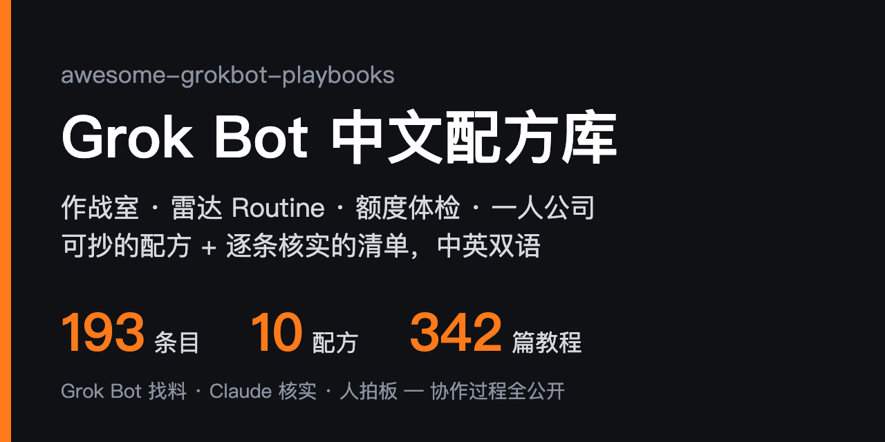

  

<h1 align="center">Awesome Grok Bot Playbooks</h1>

<b>Grok Bot 中文配方库：拿来就能跑的配方 + 逐条核实的生态清单</b>

  
  
  
  
  
  
  
  

  <b>中文</b> · <a href="README.en.md">English</a> · <a href="docs/quickstart.md">快速上手</a> · <a href="ROADMAP.md">路线图</a> · <a href="#-参与贡献">参与贡献</a>

## ⚡ 为什么看这个仓库

| | |
|---:|---|
| **197** | 个条目，每条都用 GitHub API 或页面核过：仓库存在、还在更新、确实和 Grok Bot 相关；许可证情况写在短评里 |
| **10** | 个可抄配方，统一格式：场景 → 输入 → 步骤 → prompt → 产出 → 坑，样例全部脱敏 |
| **3 级** | 验证标记：✅ 真机跑通 · 🔍 读过文档和配置 · 无标记＝只核实过仓库。✅ 只给真跑过的 |
| **346** | 篇社区教程和 X 长文精选（[社区教程](docs/community-tutorials.md) 33 + [X 大 V 文章](docs/x-articles.md) 313），加上作者自己的连载索引，每条都核过存活、作者和发布日期 |
| **2 个 AI** | 在维护：Grok Bot 每天找料，Claude Code 核实、写短评，人只拍板。协作记录全公开在 [`.collab/`](.collab/README.md) |

和英文生态导航 [awesome-grok-bot](https://github.com/ZeroPointRepo/awesome-grok-bot) 的分工：它覆盖面广；本仓侧重**中文一人公司、多 Bot 作战室、雷达 Routine 和可抄配方**。不拼数量，宁缺毋滥。

## 🤖 Grok Bot 是什么

Grok Bot 是 xAI 和 Cursor 在 2026-08-11 联合推出的 AI 队友（beta）。每个 bot 有名字、有岗位，共用一台一直开着的云电脑（浏览器、文件、终端都有）。你可以派活、让它定时跑 **Routine**、教它 **Skill**，也可以从 [模板市场](https://x.ai/bot/marketplace) 一键导入别人做好的 bot。

它和聊天助手 Grok、编码命令行 Grok Build 是三个不同的产品。

## 🚀 3 分钟上手

> 第一次用 Grok Bot？先看 **[快速上手](docs/quickstart.md)**：一个下午 5 步，从设安全底线到第一条不乱烧额度的 Routine。下面是已经上手的人的捷径。

1. **先补课**：读 [grokbot-field-notes](https://github.com/unicodef1wn/grokbot-field-notes) 的 `AGENTS.md` 和翻车记录，少走弯路
2. **要现成团队**：去 [botteams](https://github.com/ellelion/botteams) 挑一个 `installable` 团队，复制 installer prompt 粘进 Grok Bot
3. **要自己编排**：照 [作战室配方](examples/war-room.md) 拆角色、用文件交接、发布前加人工闸门
4. **找现成模板**：翻 [模板与目录](#-模板与目录)，几千个公开分享链接按岗位和质量分好了
5. **不想上云**：看 [自托管与平替](#-自托管与平替)

**先抄这 3 个配方**

| 配方 | 解决什么 | 适合谁 |
|---|---|---|
| [Routine 额度体检](examples/routine-budget.md) | 额度快烧光：先全停、再分级、逐条重开 | 开了很多 Routine 的人 |
| [作战室](examples/war-room.md) | 3–6 个 bot 只靠文件交接，发布前过人工闸门 | 想让多个 bot 分工的人 |
| [X 雷达](examples/x-radar.md) | 每天扫一轮 X，只推有信号的摘要，没信号不打扰 | 做内容、做出海的人 |

**图例**：每条＝`[名称](链接) - 短评。标签`；✅ 实测 · 🔍 已审；「配方：」是本仓自写，「模板：」可在 Grok Bot 里一键导入。

## 🆕 最近更新

- **11-05** 新增 3 个：微信 ClawBot 和 QQ 机器人接 webhook routine 的姊妹桥 [grokbot-wechatclaw-bridge](https://github.com/number5meme/grokbot-wechatclaw-bridge) / [grokbot-qqbot-bridge](https://github.com/number5meme/grokbot-qqbot-bridge)，以及在本机导出 Grok Bot 对话和附件、附 MCP 查询的 [grok-export-tool](https://github.com/LofiSu/grok-export-tool)
- **11-04** 新增 9 个：让 bot 派活给 Codex 再被叫醒的 [bot-codex-delegate](https://github.com/realTaki/bot-codex-delegate)、家用 Linux 不开公网接 T3 Code 的 [grok-bot-setup](https://github.com/nsoliven/grok-bot-setup)、一条命令配好云电脑常驻编码主机的 [aibot-hostkit](https://github.com/monarchsofchaos004-gif/aibot-hostkit)、对比发帖和收藏的趣味卡片 [Bookmark Persona](https://github.com/ItsOdeLeo/bookmark-persona)、279 个第三方 bot 的隐私优先清单 [Awesome Grok Bots](https://github.com/ctrlcmdshft/awesome-grok-bots)、中文手册站 [GrokBot Guide](https://github.com/anightmonarch/grokbot-guide)，以及开源平替 [Pots](https://github.com/Crokily/pi-durable-bot) 和复刻界面的学习 Demo [kylin-feng/grokbot](https://github.com/kylin-feng/grokbot)；又补了个人版也能用的防篡改操作台账 [grokbot-activity-log](https://github.com/deximple/grokbot-activity-log)；X 大 V 文章 313 篇
- **11-03** 新增 14 个：编码长活开跑收尾卡 [run-cards](https://github.com/rystedtcreative/run-cards)、Discord 私信唤醒 bot [grok-discord-bridge](https://github.com/RealDragonJT/grok-discord-bridge)、和 Codex Desktop 会话互发 [GrokRelay](https://github.com/w-yyh/grok-relay)、经 Herdr 接管本机编码 agent [grokbot-bridge-herdr](https://github.com/Phoobobo/grokbot-bridge-herdr)、防云电脑睡眠 [bot-keepalive](https://github.com/realTaki/bot-keepalive)、本机多 bot 看板 [Grokbot City](https://github.com/sleeplesshan/grokbot-city)、开源模板目录 [Markcial/bots](https://github.com/Markcial/bots)，以及 Nix 打包、省额度一页纸、DJ 混音流水线、只读 Strava MCP 和 agent-mesh；又补了查看和改写 bot 记忆的桌面 App [搜魂](https://github.com/Lniosy/souhun) 和同作者的 DeepSeek Harness 插件 [dsh-tool-grok-bot](https://github.com/Lniosy/dsh-tool-grok-bot)；X 大 V 文章增至 300 篇

完整记录见 [README 提交历史](https://github.com/sit-in/awesome-grokbot-playbooks/commits/main/README.md)。

## 📚 目录

- [官方与 SDK](#-官方与-sdk)（6）- 官方文档、模板市场、SDK 和命令行
- [模板与目录](#-模板与目录)（19）- 模板库、bot 分享链接索引、案例站，找现成的先翻这里
- [技能与玩法](#-技能与玩法)（78）- skill、MCP、单个模板、可粘贴人设
- [多 Bot 团队](#-多-bot-团队)（36）- 作战室、总指挥、多 agent 协作
- [Routine 与摘要](#-routine-与摘要)（12）- 定时雷达、周报、额度管理
- [中文一人公司](#-中文一人公司)（8）- 出海客服、微信接入、中文配置
- [自托管与平替](#-自托管与平替)（19）- 不想上云、想用自己的模型
- [硬件](#-硬件)（7）- 给 bot 一个实体入口
- [学习资源](#-学习资源)（13）- 教程、手册、教程索引

---

## 🧰 官方与 SDK

- [xAI API Docs](https://docs.x.ai) - 官方 API 文档，模型列表、计费、工具调用都以这里为准。标签：`official` `api` `docs`
- [xai-org on GitHub](https://github.com/xai-org) - 官方开源组织，SDK 与开源模型权重入口。标签：`official` `sdk`
- [grokbot-sdk](https://github.com/adam91holt/grokbot-sdk) - 非官方 TypeScript SDK：连本机 Grok Bot 宿主的本地网关，读写名册、记忆和对话记录；宿主没开时也能直接读本地数据目录。要网关 token，只在自己机器上用。标签：`sdk` `typescript` `unofficial`
- [grok-bot-cli](https://github.com/ScriptedAlchemy/grok-bot-cli) - 非官方命令行工具 `gbot`：在终端建、改、删 bot 和群，发消息、拉对话记录、装卸 skill，还能给本机的 Claude Code 会话发消息。直接用 Grok Bot 桌面端已登录的会话，不用手动拷 token；删除类命令会作用到整个账号，先 `list` 再动手。标签：`cli` `unofficial` `skills`
- [Grok Bot 模板市场](https://x.ai/bot/marketplace) - 官方模板目录，按销售、工程、市场、设计、运营、个人分类，点 Add 导入到自己的 Grok Bot；本仓收的单个模板大多能在这里找到。标签：`official` `templates` `marketplace`
- [botter](https://github.com/jethros-projects/botter) - 非官方 Node.js SDK 和命令行：用脚本给 Grok Bot 派活、跟读对话，也能拿同一套类型化接口做桌面客户端或看板。走的是非公开接口，随时可能失效；要装打过 10 月安全补丁的 Node.js（22.23.4 以上）。MIT。标签：`sdk` `cli` `unofficial`

[⬆ 回到目录](#-目录)

## 📦 模板与目录

- [UseGrokBot](https://usegrokbot.com/) - 第三方案例导航站：按身份分类的模板、真实用例、Bot 团队搭法和热门文章排行，支持中英日。找灵感先翻这里。标签：`directory` `use-cases` `templates`
- [kydlikebtc/awesome-grokbot](https://github.com/kydlikebtc/awesome-grokbot) - 4600 多个 x.ai/bot 公开分享链接的索引，每天查链接是否存活，每行标注出处，有可搜索网页版和中文 README。目录 CC0、代码 MIT。社区分享质量参差，导入前自己看。标签：`awesome` `templates` `directory`
- [majiayu000/awesome-grok-bot](https://github.com/majiayu000/awesome-grok-bot) - 约 4800 个 x.ai/bot 分享链接，按质量分层上架，有可搜索网页版和双语 README；作者强调「不是提示词堆」。CC0。标签：`awesome` `templates` `directory`
- [awesome-grokbot-templates](https://github.com/cs68614-hash/awesome-grokbot-templates) - 社区模板目录，只收官方 x.ai/bot 分享链接，不转存 prompt，多语种；配套站点 grokbot-templates.com 10/19 访问报错，先看仓库。CC0。标签：`awesome` `templates` `directory`
- [mergisi/awesome-grokbot](https://github.com/mergisi/awesome-grokbot) - 50 多个可粘贴的 bot 人设和销售、工程、客服、市场、运营起步队：发一个链接给 Setup bot，它就把整队建好。CC0。标签：`profiles` `teams` `templates`
- [templatesgrokbot.com](https://github.com/templatesgrokbot/templatesgrokbot.com) - 3000+ 模板按岗位检索，可经 MCP 接入；量大质量参差，当灵感库用。标签：`templates` `catalog` `mcp`
- [botdirectory.ai](https://github.com/elie222/botdirectory.ai) - 开源 bot prompt 目录，Grok Bot、Rakazo 都能用，当灵感库翻。标签：`templates` `directory` `prompts`
- [Useful Bots](https://usefulbots.pages.dev/) - 面向创作者的免费 Grok Bot 模板目录，按视频、增长、发布等分类；个人站，质量没逐个抽检，当灵感翻。标签：`templates` `creators` `directory`
- [Every Grok Bot（grokbot.rocks）](https://grokbot.rocks/) - @BrianRoemmele 维护的公开 Grok Bot 总目录：7500 多个分享链接分 26 类，每条一句说明，点开就能加到自己的 Grok Bot，作者称每周更新；可以让 bot 读这份目录，按你的目标挑 skill 补齐。目录免费，页面里有作者付费会员的推广，本仓没有逐条抽检。标签：`directory` `templates` `discovery`
- [Grok Bot Shelf](https://grokbotshelf.com) - Phillip Holland 维护的社区 Grok Bot 模板目录站：800 多个分享链接、近 200 位作者，按生活、效率、创作、商业等分类，每张卡片写一句用途、作者和来源帖，点开就能加到自己的 Grok Bot；投稿改仓库里的 `bots.json` 提 PR，几乎每天更新。网站源码在 [GitHub](https://github.com/PhillipHolland/grokbotshelf)，没有写 License；本仓没有逐条抽检。标签：`directory` `templates` `discovery`
- [GrokBotDev](https://github.com/ZeroPointRepo/GrokBotDev) - grokbot.dev 的源码仓：由一组 bot 自己运营的玩法目录，Scouts 盯 X 找真实配置，Curator 决定收录，Builder 维护网站，每次改动都走 PR。插件、用例、组合包各有页面，另有 JSON API、RSS 和 MCP，可以让你的 bot 定时订阅。和本仓「AI 找料、人拍板」的思路相近，可以对照着看。代码 MIT、内容 CC BY 4.0。标签：`directory` `agent-run` `mcp`
- [GrokBot HQ](https://github.com/V-harshith/grokbothq) - grokbothq.xyz 的源码仓：4200 多个 Grok Bot 按分类列出，另有组合包、指南，以及和 Custom GPTs 等的对比。作者称每条上架前都人工打开测过，本仓没有逐条复核。代码 MIT、内容 CC BY 4.0。标签：`directory` `combos` `guides`
- [Grok Bot 导航](https://github.com/ddhjy/grok-bot-hub) - 中文非官方 Grok Bot 目录站，在线版 ddhjy.github.io/grok-bot-hub：教程、模板、工具按栏目列出，每条一句中文说明；内容放在仓里的 `catalog.json`，加条目走 PR，提交前跑校验脚本。和本仓定位相近，可以互相补着翻。代码 MIT、目录数据 CC0。标签：`directory` `chinese` `catalog`
- [grok-bot-templates](https://github.com/ChamathRosh/grok-bot-templates) - 6 个给小商家用的免费模板：报价跟进、未接来电回复、评价回复、催款提醒、晨间简报，外加一个问你 5 个问题、帮你挑第一个 bot 的规划模板。全部只出草稿，不替你发送或付款，缺的信息留 `[FILL IN]` 不编。目前只有规划模板有一键导入链接，其余把指令贴进一个空 bot 当第一条消息就行；README 里有不少作者网站 whatshouldmybotdo.com 的导流链接。MIT。标签：`template` `small-business` `drafts-only`
- [灵境 Lingverse](https://github.com/lingverse-ai/lingverse) - 中文 Grok Bot 系列：每位「灵」是一个可一键导入的 bot，只管一件事。第一位「墨灵」专写长文，把你亲手干过的事写成长文，再改成各平台的版本。内容 CC BY 4.0、代码 MIT。标签：`template` `writing` `chinese`
- [Chief of Staff](https://github.com/twhit223/grok-bot-cos) - 幕僚长 bot 的可复刻配置：目标和待办清单、晨间重点、午间收件箱、晚间小结、睡前备好明天的会、周五收尾五条 routine，加上 1:1 准备和会议纪要两个 skill；连 Notion、Slack、日历、Gmail、Drive、Linear。官方分享链接部分团队还导入不了，可以照仓库手动建。MIT。标签：`template` `chief-of-staff` `routine`
- [Bot Catalog for Grok Bot](https://github.com/JaxonWright/bot-catalog-for-grok-bot-template) - 自更新的 bot 目录模板：从分享链接加的 bot 只是拷贝，作者之后的修复传不过来；这里每个 bot 自带一个每日 routine，查仓库有没有自己的新版本，有就给你看更新说明和 diff 链接，你同意才升级，也能让它关掉自动检查。想建自己的目录，加上 Catalog Manager 说一句「Set up my catalog」，它接 GitHub、从模板建仓、加分支保护，并记下哪些个人信息绝不能公开，涉及个人信息的内容要你在聊天里点头才推。要 GitHub 连接器；模板本身 GPL-3.0，你自己的 bot 可另选许可。标签：`directory` `templates` `routine` `github`
- [Markcial/bots](https://github.com/Markcial/bots) - 开源 Grok Bot 模板目录：派活总管 Distributed Workforce Router、长期学习的 Perpetual Learning Machine 等几个模板，各带分享链接，需要工具的还附脚本和起步文件；全是纯文本，装之前能先读、装完能改。总管会在自己做、推荐目录里的模板、给反复出现的活起草新 bot 三者之间选。MIT。标签：`templates` `directory` `router`
- [Awesome Grok Bots（ctrlcmdshft）](https://github.com/ctrlcmdshft/awesome-grok-bots) - 279 个第三方 Grok Bot 的清单，隐私和清理排在最前：从人肉搜索网站除名、挡骚扰电话、退订邮件、清理旧推文；其余是安全、家庭网络、账单保险、租房法务、购物等。分类页和数量都从一份 yaml 生成，另有组合用法和挑选建议。全是第三方 bot，加之前自己看一遍，多数在发邮件、提交表单、删除前会先问你。CC0。标签：`directory` `privacy` `templates`

[⬆ 回到目录](#-目录)

## 🧩 技能与玩法

- [配方：Teach-a-Task](examples/teach-a-task.md) - 配合 Grok Bot 自带的 Teach a Task：演示前定边界，演示后整理成可审的技能卡，先干跑再放手。标签：`example` `skill` `teach-a-task`
- [grok-bot-templates](https://github.com/cobusgreyling/grok-bot-templates) - 模板工程化：规范 + Bot Ready 打分 + team / skill / routine 目录，写自己的配方前先对照它的结构。标签：`templates` `spec` `routine`
- [botskills](https://github.com/PramodDutta/botskills) - 可直接粘贴的 bot 设定，每条都声明「哪个动作必须先问你」，护栏写法值得抄。标签：`skills` `guardrails`
- [grokbot-for-gtm](https://github.com/bcharleson/grokbot-for-gtm) - 完整外呼 GTM 流程：建名单、补全、发信到处理回复，出海冷启动获客可参考。标签：`playbook` `gtm` `outbound`
- [backlink-pilot](https://github.com/s87343472/backlink-pilot) - 给 Agent 跑的目录外链 playbook：产品上线后去导航站、免费排队发布站和 awesome 列表提交，默认每天只做 2–4 个真实提交，分保守 / 标准 / 激进三档（默认跳过付费位和强制互链），带邮件验证闭环和可复用的站点台账；人读 README、bot 读 `AGENTS.md`，DNS 验证、域名邮箱、付费等步骤必须停下来问人。v3 作者只在 Grok Bot 上跑通过，附 Grok Bot 示例；作者写明不保证排名、不教绕过搜索引擎处罚。旧版批量提交 CLI 在 `old` 分支。MIT。标签：`playbook` `seo` `growth`
- [grokbot-field-notes](https://github.com/unicodef1wn/grokbot-field-notes) - 非官方整理：xAI 团队 72 小时直播搭产品的规则、69 个角色、9 套岗位 playbook 和 40 条翻车记录，`AGENTS.md` 可直接拷。标签：`playbook` `field-notes` `agents-md`
- [grok-bot-jev](https://github.com/Bodila51/grok-bot-jev) - 在昂贵的调研/重试前加一层低成本分类决策，省调用量的思路值得抄；依赖第三方 TypeSafe 服务。标签：`skill` `cost` `decision-layer`
- [agent-cookie-sync](https://github.com/markfulton/agent-cookie-sync) - 把本机 Chrome 已登录站点交给云端 bot，不贴密码；等于把账号权限交出去，只给低敏账号用。标签：`chrome` `session` `security`
- [devspace](https://github.com/Waishnav/devspace) - 极简的 MCP 编码 harness，让 Grok Bot、Claude、ChatGPT 等通过 MCP 拿到读写代码的能力。标签：`mcp` `coding` `harness`
- [Bland 电话 MCP](https://docs.bland.ai/integrations/mcp/grok-bot) - 第三方官方文档：给 Grok Bot 接上 Bland 的 MCP，用专属号码打电话、发短信，出海外呼可用；bot 能在对话里自己付费开户，务必先设人工闸门。标签：`mcp` `voice` `outbound`
- [模板：Grok Bot Command Line（Brian Roemmele）](https://x.ai/bot/PKtdrwJNC54pLQIAT3H60) - 第三方模板，可一键导入：用免费 Google Voice 号接 Gmail，发短信或留语音、报出暗号就能给 bot 派活，结果短信回你，没网只有信号时也能用；紧急事项 bot 也能主动发短信给你。Google Voice 国内号码申请不了。标签：`template` `sms` `voice`
- [grokbot-imessage-skill](https://github.com/jeffhuber/grokbot-imessage-skill) - macOS 上让 Grok Bot 读、搜、分拣 iMessage，发信先预览再确认；要开完全磁盘访问权限，等于把全部聊天记录交给 bot，慎用。标签：`skill` `imessage` `macos`
- [grok-bot-skill](https://github.com/adamanz/grok-bot-skill) - 装进 Claude Code、Cursor、Codex 的技能：在终端里给 Grok Bot 队友发消息、新建 Bot，走本机已登录的 Grok Bot 桌面端。标签：`skill` `cli` `claude-code`
- [lauren-poteto-rules](https://github.com/unicodef1wn/lauren-poteto-rules) - 把工程原则做成 Grok Bot 私有技能：先看证据再下结论，在真实产品里验证，反复纠正的事写成固定约束；作者同 grokbot-field-notes。标签：`skill` `engineering` `rules`
- [web-access](https://github.com/eze-is/web-access) - 给本机 agent（Claude Code、Grok Bot 等）装联网能力：三层通道调度、浏览器 CDP、并行抓取，自动积累站点经验；作者同 eze-grokbot。README 声明 MIT，仓内没有 LICENSE 文件。标签：`skill` `browser` `cdp`
- [模板：Motion Director](https://x.ai/bot/MdpeJPD6eiY7YWUa9bfes) - 第三方模板，可一键导入：一句话（产品链接、主题或一首歌）出成片，逐镜头动画、按人声做口型、本机 GPU 放大，附分镜表和质检结果。页面没标价，导入即同意 bot 分享条款。标签：`template` `video` `creative`
- [locum](https://github.com/HarjjotSinghh/locum) - 自定义 MCP 连接器加隧道，让 Grok Bot 把编码活交给你本机已登录的 Claude Code / Codex，只调用官方命令行，不碰凭证。等于把云端 bot 和本机订阅接起来；隧道开着期间注意权限面。标签：`mcp` `delegate` `claude-code`
- [wingman](https://github.com/juangurdian/wingman) - 本机 MCP 桥：让 Grok Bot（也支持 Cursor 等 MCP 客户端）列出你本机 Codex / Claude Code 的会话、读对话记录、发消息、打断当前这一轮，你在终端里照样看得到。`npx wingman-mcp` 一条命令配对，生成 bearer token，再用 Tailscale 或 Cloudflare 隧道把端口给云端 bot。和 locum 思路相近，locum 是派新活，wingman 是接管已开着的会话；隧道选不对外公开的那种，token 别外泄。MIT。标签：`mcp` `bridge` `claude-code`
- [claude-grok-bridge](https://github.com/francoCosimo95/claude-grok-bridge) - Claude Code 和 Grok Bot 双向互通：在 Claude Code 里说一句「ask Grok Bot …」，问题交给 bot，约 30 秒后答案回到原会话；bot 也能反过来问 Claude。走两边各自的 routine 端点，没有中间服务器、不用拷 key；给 bot 发一行安装指令，它自己装好两边并跑自检。消息只当数据，回答不算批准。零依赖，MIT。标签：`bridge` `claude-code` `routine`
- [Grok Bot Bridge](https://github.com/runesleo/grok-bot-bridge) - 让 Claude Code、ChatGPT 或任意脚本经 webhook routine 给 bot 派活：每个任务带 job id、本地账本防重复发送，超时标 UNKNOWN 不盲目重试；bot 第一行回 `BRIDGE_RESULT <job_id>`，一条 `harvest` 命令把答复收进文件（读桌面端本地会话副本）。纯 Python 标准库，中英文档。和上面的 claude-grok-bridge 思路不同，可以对比着挑。MIT。标签：`webhook` `claude-code` `routine`
- [Grok Bridge](https://github.com/niharnm/grok-bridge) - 一个命令行在 Grok Bot 和 Codex、Claude Code、Cursor、Antigravity、Muse Code 之间双向交接任务：把一件边界清楚的活交出去，拿回结果再接着干。连 Grok Bot 用的是社区版 grok-bot-cli，走桌面端会话的非公开接口；反向调用要你批准 bot 在本机执行命令。作者自标实验性 alpha。MIT。标签：`bridge` `cli` `multi-agent`
- [gb2gpt](https://github.com/EdmundLimBoEn/gb2gpt) - 在 ChatGPT 对话里给你的 bot 团队派活：自托管一个小 Python 服务，经 ChatGPT 开发者模式 MCP 把任务交给专门的中继 bot，再转给总管；非官方。要付费 ChatGPT（开开发者模式）和一个 HTTPS 公网地址，许可是 CC BY-NC 4.0，不能商用。标签：`chatgpt` `mcp` `relay` `self-hosted`
- [grokbot-cli](https://github.com/Nuncio-hq/grokbot-cli) - 在终端或 Claude Code / Codex / Cursor 里指挥你的 Grok Bot：派活并等最终回复、回复某条消息、处理审批卡、招 bot、管 skill 和 routine；同一套命令也有 MCP 和 TypeScript SDK。bot 云电脑上装一个 inbox skill，bot 想交给你本机助手的活（修 bug、待核的结果）约 1 分钟内能收到。非官方，复用桌面端的登录调用未公开接口，接口一改可能失效；删除、批准这类命令要加 `--yes`，先拿测试 bot 试。只支持 macOS。MIT。标签：`cli` `mcp` `sdk`
- [gbb-multica-bridge](https://github.com/lthero-big/gbb-multica-bridge) - 让 Grok Bot 当 Multica 的 agent 运行端：Multica 里派的任务经 webhook 交给 bot，回答和查询、新建、编辑的结果再带回 Multica 聊天。运行端和回传端可以同机直连，也可以跨机走 SSH，不用公网隧道；交互式安装向导，bot 云电脑被清空后能一键恢复回传助手。基于 grok-bot-bridge（gbb），中文 README。MIT。标签：`multica` `webhook` `bridge` `chinese`
- [iMessage Relay](https://github.com/PhillipHolland/imessage-relay) - 在 X Chat 里收发 iMessage：你选定的联系人发来的短信转进一个 X Chat 对话，你在那里回复，再经你自己常开的 Mac 发回 iMessage。安装由配套的 iMessage Relay bot 引导，下载固定版本并校验 sha256；要另备一个专门转发的 X 账号。只读打开 chat.db，正文不落盘，回复默认先 dry run。会碰到你的私信，装前看清权限。MIT。标签：`imessage` `x-chat` `macos`
- [Grok Bot Clipper](https://github.com/RongleCat/grok-bot-clipper) - 非官方浏览器扩展（Chrome / Edge / Firefox）：剪藏网页、截图、文件和社媒帖，攒进素材篮后直接发给自己的 bot，不走第三方中转。作者同铁柱学习站；目前只发源码，要自己构建。核心代码 MIT，第三方部分另有许可。标签：`browser-extension` `clipper` `chinese`
- [Send to Grok Bot](https://github.com/jamespendry/send-to-grok-bot) - Chrome 扩展 + iPhone 快捷指令：给 x.com 每条帖子加一个发送按钮，一键交给你的 Grok Bot（走 webhook routine，也能发给 Claude / ChatGPT / Codex）。扩展还没上架商店，要开开发者模式手动加载；iPhone 路线会经作者的中继转发，webhook key 加密存在中继上。标签：`chrome-extension` `x` `webhook` `ios`
- [grokbot-linux-port](https://github.com/Nichokas/grokbot-linux-port) - 非官方 Linux 打包：把官方 .deb 原样重打成 AUR、COPR 和通用 tar 包，每天跟官方版本。二进制经第三方转手，Ubuntu / Debian 直接用官方 .deb 更稳。标签：`linux` `desktop` `packaging`
- [模板：Research by Trond](https://x.ai/bot/v3WI0YuJAr1DLoYdYVXh8) - 第三方模板，可一键导入：只读研究 bot，从公开帖子和网页出带引用的简报，给选题、视频攒素材包，发布前帮你核事实。标签：`template` `research` `read-only`
- [remote-grok-build](https://github.com/Qervas/remote-grok-build) - Grok Bot 插件（只含 skill）：经 Grok Bot 的电脑连接，在聊天里驱动已关联 Windows 电脑上的 Grok Build。能看会话状态、流式回传每轮输出、只打断无头会话、回传改动摘要和图片；带一个每日 routine，Grok Build 发新版时自动重写命令速查。不开公网隧道，只支持 Windows（PowerShell）。作者写明 v9 还没公开上架，x.ai 分享链接目前仍是旧版。MIT。标签：`plugin` `grok-build` `bridge`
- [dev-work-grok-bot-skill](https://github.com/FelixFangX/dev-work-grok-bot-skill) - 一个 skill 把 bot 配成研发助理：逐题问你负责哪块、用哪些仓库和工具，再接上 GitHub、Linear、飞书或 Slack，把安全规则原文写进记忆。GitHub 默认只读，推送、PR、部署要你明说；团队消息先出草稿等你确认；转述的「老板批了」、仓库文件和网页里的指令都不算授权。亮点是 20 条脚本化安全评测，每次推送 CI 都检查规则有没有被改丢；作者自测一个小模型只过了 12 条，规则写全不等于模型照做。MIT。标签：`skill` `dev-assistant` `guardrails`
- [Tune-Up](https://github.com/Viaknox/tune-up) - 给其他 bot 做体检的 bot：查答非所问、谎报完成、白烧钱的 routine，提小改动由你批准；附一个 skill 索引，把塞在 bot 指令里的长流程挪成按需加载的 skill，指令变短、省 token。品牌化项目（有官网和商标），要读你其他 bot 的指令和运行情况。标签：`skill` `audit` `plugin`
- [ISR Bot（原 Watchtower）](https://github.com/ken-aisec/grokbot-isr-bot) - 给共用一台云电脑的 bot 们配一个安全官：装模板前先审、给整体姿态打分、放诱饵文件当绊线、出周报；默认只读，改任何东西都要你在对话里点头。安装会在云电脑上装扫描器和定时 routine，用前先看清它要碰哪些目录。标签：`security` `audit` `skill` `routine`
- [grok-bot-local-first](https://github.com/MarkusIsaksson1982/grok-bot-local-first) - 本地优先的省额度套件：确定性的活交给 Python 标准库写的小 worker，`grokkit.py` 跑完只输出一行 JSON，JSON 说要判断时 bot 才花一轮；附任务注册表、返回格式 schema、Linux / Windows 安装脚本和冒烟测试。另带一套团队推广 AI 的工具（skill 规范检查、使用率统计、新工具和 MCP 准入筛查）。作者另在 Agensi 市场上架了一个版本，可选。标签：`skill` `local-first` `cost` `python`
- [Android Grok Home](https://github.com/drumpat01/android-grok-home) - 非官方 Android 桌面启动器（Android 11+，装 APK，不刷机）：动画头像墙一眼看全队谁在干活、谁举手等你、谁做完了，每个 bot 单独的语音和文字对话。经你电脑上的 BDK（@cursor/bdk）桥接到你自己已有的 bot，仓里不带账号和 key，有 Demo 模式。要自己构建 APK、电脑上常驻桥接服务；桥接端口只留在本机，远程访问走私有 Tailscale；部分功能用了未公开接口，上游升级后可能失效。标签：`android` `launcher` `bdk` `voice`
- [Grokbot Widget](https://github.com/imranbarbhuiya/grokbot-widget) - macOS 桌面悬浮小伙伴（macOS 14+）：可拖动的角色加展开式聊天面板，经 BDK 和你已有的一个 bot 对话，release 包自带 Node，不用开终端。本地服务只监听本机端口；release 没做 Apple 公证，第一次打开要在系统设置里手动放行；bot 名字写错时 BDK 可能新建一个空 bot。标签：`macos` `widget` `bdk`
- [TetherBot](https://github.com/GrokkingGrok/TetherBot) - 把 GNOME 桌面接到 Grok Bot：顶栏显示 bot 状态、弹通知、快捷操作，桌面经 webhook routine 发给 bot，bot 的产出经私有 GitHub 数据仓回到桌面。本机常驻一个用户级守护进程，密钥存系统密钥环。pre-alpha，许可证 GPL-2.0-or-later。标签：`gnome` `linux` `desktop` `webhook`
- [Grok Bot for Omarchy](https://github.com/hmarquez-solutions/omarchy-grok-bot) - Omarchy（Arch Linux 桌面）顶栏插件：一张 Grok Bot 小脸，休眠、空闲、干活、有未读、等你五种表情，等你时旁边显示是哪个 bot；点开面板，卡在你这儿的 bot 和原因排最前，其余列出最后一句话和未读数。只读桌面端写在本机的状态文件，不连服务器、不读凭证、不往 bot 目录写东西；「干活中」靠文件写入推断，慢回复可能误判成空闲。标签：`linux` `desktop` `status`
- [Bot Beacons](https://github.com/SnazzyGaz/bot-beacons) - Windows 桌面上一个 bot 一个悬浮小头像（也可以收成贴在屏幕边的标签）：bot 做完事、要你批或要你登录时会发光并显示一句摘要，点一下直达那个 bot 的聊天，中键点它就能叫它干活，小事可以直接在气泡里回。把仓库链接发给桌面端的 bot，说「帮我装上」，它按 SETUP 文档装好、配对、建好转发回复的 routine。消息经免费的公共 ntfy.sh 中继，全程加密签名，也可以换成自建 ntfy；exe 没有代码签名。MIT。标签：`windows` `desktop` `notifications`
- [Grok Bot Voice（Omarchy）](https://github.com/StefMVP/omarchy-grokbot-voice) - Omarchy 热键开始、静音、挂断 Grok Bot 语音通话，不抢键盘焦点，屏幕上一颗小药丸显示通话状态。安装会给桌面端加本地调试端口（9222），bot 的 agent id 要自己从 DevTools 里抄；非官方。可和上面的 Grok Bot for Omarchy 一起用。MIT。标签：`linux` `voice` `hotkey`
- [GrokDeck](https://github.com/Gamedesigner/grokdeck) - 第三方 Mac / Windows 客户端，给 bot 多的人用：置顶、分组（和 Grok Bot 同步）、按活跃度排序、搜缓存的对话、直接看和操作 bot 的云电脑；iPhone 版经同一局域网配对桌面助手使用，暂不支持出门远程。读本机已登录的 Grok Bot 安装，凭证只留在内存、只发往官方接口，无统计；走非官方接口，只适配特定桌面端版本，目前是预览版。MIT。标签：`desktop` `ios` `client`
- [Homebot](https://github.com/lumpinif/Homebot) - Mac 应用：用 iPhone 或 HomePod 的 Siri 问自己的 Grok Bot，Siri 把回答念出来，点四步就配好，不用开终端，支持多轮对话。要一台常开的 Mac 和 iPhone 在同一 Wi-Fi，局域网走明文 HTTP，别做端口转发；早期版本、没走 Apple 公证，作者标了几处尚未实测。MIT。标签：`siri` `homepod` `voice`
- [Agent Harbor](https://github.com/TommyBez/agent-harbor) - macOS 工作区：把 Claude Code 和 Codex 会话放进独立 tmux 常驻，你在桌面 App 里看终端、接管、恢复，Grok Bot 通过桌面端的本机命令执行调用同一个控制器派活和续聊，不开公网服务。要开桌面端本机执行，等于让 bot 动你的电脑；早期实验版，先在授权的测试项目上试。标签：`claude-code` `codex` `tmux` `macos`
- [grok-bot-mcp](https://github.com/cherwinyu/grok-bot-mcp) - Windows 本机 MCP 桥：把一个限定范围的编码任务交给 Grok Bot routine，只提交一次，再用 git diff 和留存的证据验收，不看聊天里的「已完成」。管理员先锁定 Git 根目录、可改文件和测试命令；附离线演示，不连账号也能先试。作者标实验 Beta、非官方，有中文 README。标签：`mcp` `windows` `coding` `routine`
- [grokbot-skills](https://github.com/dallintwatts/grokbot-skills) - 解决「导入模板不带 skill」：bot 第一次对话先问「要我完成设置吗」，你同意后它从固定 commit 下载 skill，按 `PINS.txt` 里的 sha256 和文件大小逐个校验，对不上就不装。仓里是 Second Opinion Council、Fleet Doctor 两个模板的 skill，这套校验做法可以照搬到你自己分发的模板。MIT。标签：`skills` `templates` `sha256`
- [grokbot-skills（datadda27）](https://github.com/datadda27/grokbot-skills) - 和上一条思路相反：两个公开模板（大学橄榄球招生与转会追踪、让一家人能在家撑两周的应急储备 Prepper）每次运行前都从这个仓拉最新 skill，作者一修所有用户马上生效。每个模板有设置页，写清职责、硬规则、routine 和安全边界，一个只读，一个从不替你下单。代价是仓库里改了什么，你的 bot 下次就照着跑，在意的话 fork 一份钉住版本。MIT。标签：`skills` `templates` `auto-update`
- [Unfinished Botness](https://github.com/brefledev/unfinished-botness) - 导入的模板缺 skill 时的救援包，自带一个助手 bot「Patch Cassidy」：报上被导入 bot 的名字，它让那个 bot 直接导出全部 skill，逐个标 PASS / FAIL / UNVERIFIED，列出缺的引用；模板作者也能用它导出可读源码、给分享包做校验。零依赖、不写你的账号，导出失败才退到看截图重建。作者标了实验性，完整来回还没实测。MIT。标签：`skills` `templates` `import`
- [Personal Chef](https://github.com/anselmcmakin/personal-chef) - 家庭周菜单模板，[一键导入](https://x.ai/bot/gMrnNpgylgu11PImcWTdy)：先问 6 个问题（几口人、过敏、忌口、预算、做饭时间、邮编），每周六 routine 排出下周晚餐，过敏是硬规则、超预算就重排；产出可打印的菜谱卡和按超市区域分好的购物单，再在 bot 的浏览器里填好 Walmart 购物车，由你登录、结账，bot 不付款、不改地址。仓里的 skill 只有说明没有代码；首次运行会请求一次仓里的 release 文件来计安装数，不带个人信息。MIT。标签：`template` `routine` `family` `shopping`
- [grok-bot-agents](https://github.com/AgwaB/grok-bot-agents) - Grok Bot 技能插件：在 bot 的云电脑上装好 Claude Code、Codex CLI、Pi、omp，轻活 bot 自己做，重活（5 个文件以上、大日志、要跑几分钟以上、反复改测）按成本和难度路由给某个 CLI 无头执行，回一段摘要和产出路径；也能经 webhook routine 和别的机器上的 agent 双向交接。从本机导入设置和 key 要逐个文件点同意，key 不进聊天；有韩文 README。标签：`skill` `delegation` `claude-code` `codex`
- [Follow-Through](https://github.com/jeffgreendesign/follow-through) - 家务责任提醒模板：生日、每周聚餐、补货这类周期性的事，每件记下周期、怎样算做完、提前几天准备；你一问它就说今天该做什么并给一个下一步，没有你的话或来源从不标「已完成」，断了一阵也不刷屏催。默认只聊天、不带 routine、不需要账号；装法是把 `bot-instructions.md` 粘成 bot 说明再加两个 skill。标签：`template` `household` `reminders`
- [my-bot-scripts](https://github.com/wustep/my-bot-scripts) - 一位用户日常配 Grok Bot 用的脚本箱，每个目录能单独抄：个人号和工作号 bot 之间的加密中继（经 Notion 路由，附 MCP 入口）、iMessage 收件 bot 把短信分给其他 bot、按 bot 统计消息量的热力图、把工作和个人账号分开的「工作版」App 副本；附两个 bot 的说明和 routine 可直接粘贴。脚本默认跑在 bot 云电脑上，路径都能用环境变量改；部分要 Vercel、Notion 或第三方 API。标签：`scripts` `relay` `imessage` `notion`
- [Holdt](https://github.com/holdtapp/holdt) - 让 Grok Bot 读写 iCloud 日历的 MCP，部署在你自己的 Cloudflare 账号上；每次改动先出预览，bot 要先问过你。把仓里的安装文档链接发给 bot 就能装，不用开终端。要给它一个 Apple 专用密码，这个密码能碰的不只是日历。MIT。标签：`mcp` `calendar` `icloud`
- [grokbot-box-heal](https://github.com/heyalchang/grokbot-box-heal) - 云电脑自愈脚本：平台重置、换机或休眠之后，自动装回 Tailscale、常用软件包和 gh 登录态，并修好休眠后假在线的 Tailscale 连接。云电脑上所有 bot 共用一个带 sudo 的用户，装前看清它改了哪些文件。MIT。标签：`cloud-computer` `tailscale` `recovery`
- [Grok Bot Backup](https://github.com/company-notes/grok-bot-backup) - 把共享云电脑里的人设、记忆、对话和附件导出成原始文件加可读 Markdown，换助手或交接时用；不想自己跑脚本，可以导入作者做好的备份 bot，按向导选存 Google Drive 还是本地、多久备一次。作者在真实云电脑上测过。导出的 ZIP 没有密码，可能含私密对话和凭证，务必放私密位置。MIT。标签：`backup` `export` `privacy`
- [Grok Box](https://github.com/dorukardahan/grokbox) - bot 云电脑的持续加密备份，类似 Time Machine：用 restic + rclone 把 `/workspace` 和 `/home/box` 增量备份到你自己的 Google Drive，免费 15 GB 用精简档就够，不要 root、不经别人的服务器。把仓库链接给 bot，它按 AGENTS.md 装，你只需存好恢复密码、建一个 Google OAuth 客户端（约 10 分钟）、点一次授权；`doctor.sh` 和 `test-restore.sh` 检查备份能不能真的还原。默认连凭证一起备份（在加密库里），不想要可以关。MIT。标签：`backup` `restic` `google-drive`
- [Tesla Grokbot Connector](https://github.com/naoiseirwin/Tesla-Grokbot-Connector) - 只读的 Tesla Fleet API MCP：问 bot 车还剩多少电、这周开了多远、续航有没有掉，不能控车；在你自己的 bot 云电脑上以 stdio 命令运行，不对公网开放，VIN 打码。要自己申请 Tesla 开发者应用，非官方。MIT。标签：`mcp` `tesla` `read-only`
- [Grok Bot Vehicle Fleet](https://github.com/matthew-rutledge-dev/grokbot-vehicle-fleet) - 社区 MCP 插件加一组 skill，经官方 Fleet API 读特斯拉车况（电量、空调、门锁、胎压、粗略位置等）：默认只读、先读缓存、不主动唤醒车；打开命令开关后才能下指令，每条都要你确认，不做定时或自动控车，作者写明不能用于紧急或安全场景。要用你自己的开发者应用和令牌，近一周连发了多个版本。MIT。标签：`mcp` `tesla` `vehicle`
- [grokbot-tunnel](https://github.com/exa-pub/grokbot-tunnel) - 把没有桌面的 Linux 服务器（VPS、家用服务器、容器、树莓派）挂成 Grok Bot 的一台本地电脑，bot 能在上面跑命令、改文件；一个 Go 静态二进制，systemd 常驻、开机自连、自动更新，命令权限分 ask / always / never。非官方；连上期间 bot 能在服务器上执行命令，别挂在放敏感数据的机器上，权限先设 ask。有 CI 和 Release。MIT。标签：`linux` `server` `computer`
- [bots skill（raphaelsalaja/skills）](https://github.com/raphaelsalaja/skills/tree/main/skills/bots) - 把挑中的 Grok Bot 放上个人网站：先把一段提示词贴给主 bot，它列出全部 bot 等你挑，再让每个 bot 自查邮箱、客户名、内部链接、key 等隐私并提修改，你批了才改；发布模板仍由你自己点 Publish、复制链接贴回来。编码 agent 再据此生成一份数据文件、可拖动摇晃的 bot 堆、卡片和组织架构页，外形和配色取自 bot 的公开页。属于作者一套界面类 skill 合集，用 `npx skills add raphaelsalaja/skills` 安装，要 matter-js。MIT。标签：`skill` `portfolio` `share` `privacy`
- [Desk](https://github.com/TeebooTed/desk) - 本机单文件项目看板（浏览器直接打开 `file://`），按项目和进度排，不是看板列：「Message bot」框经本机 relay 把消息发到 webhook routine，另一个每天两次的 routine 回写 status.json 刷新进度。把 README 里的设置提示词贴给 bot 就能装好，webhook key 只写进 relay 配置。数据默认留在本机，可选接 Solid pod。一行安装走 `curl | bash`，会装本机 relay 和开机自启，介意就先 clone 下来看 install.sh。MIT。标签：`dashboard` `webhook` `routine` `local`
- [Grok Bot Inbox](https://github.com/mascarock/grokbot-inbox) - 给 bot 收到的邮件做一个网页收件箱，部署在你自己的免费 Vercel 项目：每来新信 bot 就推一份加密快照，key 在链接 `#` 后面、不经服务器，网页只存密文。在网页里点回复只给 bot 留加密草稿，约 15 分钟内 bot 在聊天里出草稿卡，你确认才发出。README 里的一键模板链接还是占位符，目前要按说明自己部署；有在线 demo。MIT。标签：`email` `inbox` `privacy` `vercel`
- [run-cards](https://github.com/rystedtcreative/run-cards) - bot 把长编码活交给 Grok Build 或 Claude Code 时，在命令前套一层 run-cards：开跑贴一张卡（工具、模型、effort、提示词），结束贴一张如实的收尾卡（是否通过、耗时、token、输出开头），各出 PNG 和 Markdown 两版，聊天里一眼看出到底跑完没有；也能当普通 CLI 包装用。非官方。MIT。标签：`coding-agent` `status` `cli`
- [grokbot-mixer](https://github.com/davidgeorgehope/grokbot-mixer) - 让 Grok Bot 当 DJ 的 DnB 混音流水线：分析整首曲目挑没有人声的混音点，16 小节等功率交叉淡化，带护栏脚本、自动修正和 eval 打分器，能出 60 分钟以上的连续混音和配套可视化。是作者 bot 工作区的代码快照，不含音频，要自备曲目；适合参考创作型 bot 怎么加护栏和打分。MIT。标签：`music` `creative` `eval`
- [grok-discord-bridge](https://github.com/RealDragonJT/grok-discord-bridge) - 你自己的 Discord bot 收到私信或被 @ 时，把事件 POST 到 Grok Bot routine 的 webhook 唤醒 bot，bot 再用同一个 bot token 经 Discord REST 回复；没有共享 bot 和中转服务，带主人白名单。附 AGENT-SETUP.md 可让 agent 自己装，你只需提供 bot token、webhook URL 和 key。MIT。标签：`discord` `webhook` `routine`
- [GrokRelay](https://github.com/w-yyh/grok-relay) - 让 Grok Bot 和 Codex Desktop 里已有的会话互相找到、互发消息，回复回到原会话，两边都保留各自上下文，两个 App 里都能看到往来。Windows 公测 alpha，桌面适配走内部或不稳定接口，非官方；中文文档。MIT。标签：`codex` `bridge` `windows`
- [grokbot-bridge-herdr](https://github.com/Phoobobo/grokbot-bridge-herdr) - 经 Herdr 让 Grok Bot 启动、盯住、接管本机编码 agent（grok、codex）的窗格，也能把你自己的窗格交给 bot、随时收回；agent 变成 done / idle / blocked 时只往 webhook 发一条不含终端输出和密钥的小 JSON，带去重。也能配 ChatGPT dots 用。中英文档。MIT。标签：`herdr` `coding-agent` `webhook`
- [grok-bot-nix](https://github.com/ponelat/grok-bot-nix) - 非官方 Nix 打包 Grok Bot Linux 桌面端（官方 AppImage）：钉版本并校验 hash，或每次启动自动拉最新版；flake 和传统 configuration.nix 都能用。仓里只有 Nix 代码，构建时从官方 CDN 下载，不分发 Grok Bot 本体；x86_64 实测，aarch64 未测。MIT。标签：`linux` `nix` `desktop`
- [bot-keepalive](https://github.com/realTaki/bot-keepalive) - 长任务防云电脑睡眠的 skill：云电脑空闲约 5 分钟就挂起，后台 nohup、tmux 一起冻住，routine 最短 5 分钟、还会延迟，补不上。它登记要守的任务，由一个 low effort 子 agent 约每 13 分钟调一次工具保持活跃，任务都结束才停。守护期间持续耗额度，作者自测约每天 180 万 token。中英文档。MIT。标签：`skill` `computer` `long-running`
- [strava-grokbot-bridge](https://github.com/naoiseirwin/strava-grokbot-bridge) - 只读 Strava MCP（fork 自 eddmann/strava-mcp）：装在你自己的 Grok Bot 云电脑上，bot 以 stdio 命令启动，没有公网入口；Strava 授权在云电脑上用 Take over 完成，token 不进聊天。非 Strava 官方；同作者另有上面的 Tesla 连接器。MIT。标签：`mcp` `fitness` `read-only`
- [agent-mesh](https://github.com/xiaozhenliu/agent-mesh) - 把本机 Claude Code、Codex、pi、DeepSeek Harness 会话和云端 Grok Bot 拉进同一个私有 Reason Network 团队，哪边都能先开口，回复会唤醒对方；不需要公网 IP、Docker 或单独的服务器。仅 macOS，附 agent 安装手册、云端设置和 routine 提示词，中英文档。MIT。标签：`coding-agent` `bridge` `routine`
- [搜魂](https://github.com/Lniosy/souhun) - Mac / Windows 桌面 App，查看、写入、忘掉 Grok Bot 的记忆：左边列出本账号的 bot，拉取一份记忆并标出是账号共用、仅此 Bot 还是团队的；写入前选「账号共用 / 仅此 Bot」和「指令 / 普通事实」，忘掉按原文匹配。个人记忆没有直接接口，读写都发给所选 bot 代办，会出现在它的对话里；不写团队记忆、不改人设和技能、不存令牌。非官方：读本机桌面端的登录记录（Mac 经钥匙串）调未公开接口，客户端一更新就可能失效。有安装包，中英文档。MIT。标签：`memory` `desktop` `unofficial`
- [dsh-tool-grok-bot](https://github.com/Lniosy/dsh-tool-grok-bot) - DeepSeek Harness 插件：在 Harness 对话里给指定 bot 或团队房间发话并取回回复，同一句话最多分发给 8 个 bot，也能请 bot 在它自己的云电脑上做事、把结果文字贴回来，还能回忆、导出、写入、忘掉云端记忆；这些消息都会出现在 bot 的官方对话里。和搜魂同作者，同样非官方：直接读本机已登录的 Grok Bot，没装桌面端时才把 token 写进 `~/.dsh/grok-bot.json`，这个文件别提交。MIT。标签：`deepseek` `plugin` `memory` `unofficial`
- [grok-bot-setup（T3 Code）](https://github.com/nsoliven/grok-bot-setup) - 家里的 Linux 机器不开公网也能接 bot，第一个集成是 T3 Code：本机 watcher 只读 T3 的数据库，线程真在等你（问题晾了 10 分钟、跑完 30 分钟没看）才成批发给 webhook routine，只发标题、状态这类元数据；你在聊天里回一句，bot 经你自己的 Cloudflare Tunnel 登录 T3 自带的 MCP，先给你看原话、你确认后才贴回线程。隧道只出站、只放行登录和 `/mcp` 路径，其余页面要邮箱验证码。要 Linux + systemd、Bun，以及开了 Zero Trust 的 Cloudflare 域名（只要提醒的话不用）。读的是 T3 的本地库，非官方，T3 升级可能失效。MIT。标签：`t3code` `webhook` `mcp` `cloudflare`
- [aibot-hostkit](https://github.com/monarchsofchaos004-gif/aibot-hostkit) - 一条命令把 bot 的云电脑配成常驻编码 agent 的主机：装好 Claude Code（也可选 Codex、Gemini，或只守护你自己的脚本），放进 tmux，挂了自动拉起，出事推送到手机。可以你自己逐题回答安装，也能让 bot 先用 `--plan` 念给你听、你选好再跑。针对「所有 bot 共用一台云电脑」带了 `aibot lock`，免得两个 bot 同时改同一处。安装走 `curl | bash`，介意就先看 install.sh；普通 Linux VPS 也能用。有繁中 README，非官方。MIT。标签：`computer` `claude-code` `tmux` `setup`
- [bot-codex-delegate](https://github.com/realTaki/bot-codex-delegate) - 让 bot 像项目里派云端 agent 一样用 Codex：云电脑上常驻 `codex app-server`（只听 localhost），bot 把活交给一个低开销的等待子 agent，完工再被叫醒，主聊天不用一直盯，额度花在 Codex 上；跑到一半能追加指令或打断，同类任务复用同一个会话。默认 `workspace-write` 加按需审批，完全放权要自己开。和上面的 bot-keepalive 同作者，用同一招保持云电脑不睡。中英文档。MIT。标签：`skill` `codex` `delegate`
- [Bookmark Persona](https://github.com/ItsOdeLeo/bookmark-persona) - 可一键导入的模板（也打包成插件）：经 X 插件读你最多 200 条帖子、300 条收藏和 600 个赞，对比「发出来的你」和「收藏里的你」，各给一个四字母类型、一只宠物和昵称，出一张分享卡，也可以选只显示类型的私密版。互粉帖、抽奖、单个表情不计。纯娱乐，不是性格测试，数据留在你自己的 bot 里。代码和 16 只宠物美术都是 MIT。标签：`template` `x` `fun` `share-card`
- [grokbot-activity-log](https://github.com/deximple/grokbot-activity-log) - 给个人版 Grok Bot 补一份防篡改的操作台账（官方的操作记录和审计日志只给企业版）：skill 规定 bot 干活时用 `gblog` 记下任务起止、浏览器动作和审批通过或拒绝，每个 bot 一条哈希链，改、删、截断任一行 `verify` 都报 FAIL；写盘前先抹掉常见形状的 key 和密码，每日审计 routine 出报告推到你自己的仓，推公开仓会被拒。还能自动抓命令、浏览记录和文件改动，对照 bot 自报的覆盖率，每周据此提改人设、skill、routine 的建议等你批。单文件 Python 标准库，有测试和 CI。MIT。标签：`skill` `audit` `routine` `security`
- [grok-export-tool](https://github.com/LofiSu/grok-export-tool) - 把本机已登录 grok.com 账号里的 Grok Bot（名册、完整对话、附件）和普通 Grok 对话导出成 JSONL、Markdown 和原始 JSON；附只读的 MCP 服务（列 bot、取对话、搜索）和 skill，让 Claude Code、Codex、OpenCode 查这份归档。不发消息、不要 key。非官方：自动读本机 Chrome 的 cookie（Mac 经钥匙串、Windows 经 DPAPI），走 grok.com 未公开的接口，改版就可能失效；导出里有私密对话，放好。和 Grok Bot Backup 不同，它在你自己电脑上跑，不进云电脑。中英教程。MIT。标签：`export` `backup` `mcp` `unofficial`

[⬆ 回到目录](#-目录)

## 👥 多 Bot 团队

- [配方：作战室](examples/war-room.md) - 3–6 个 bot 只靠文件交接、不串聊，发布前过人工闸门；本仓 Claude ⇄ Grok 协作就是这套。标签：`example` `multi-bot` `war-room`
- [配方：内容流水线](examples/content-pipeline.md) 🔍 - 找料、起草、审稿、发帖拆给不同 bot，只靠文件交接；发布前人点一次批准，一次性 routine 发帖并复查，每晚对账。标签：`example` `multi-bot` `x` `content`
- [配方：研发四角色](examples/dev-four-roles.md) - 需求 / 复现 / 出 PR / 验 PR 拆给四个 bot，产出和裁决分开，人只在批准 spec 和合并两处点头。标签：`example` `dev` `guardrails`
- [botteams](https://github.com/ellelion/botteams) 🔍 - 一个 markdown 文件装一整支团队（bot + 群聊 + routine），看作战室怎么一次性编排的好样例；注意 `connector_modes` 只是 prompt 约束，不是权限。标签：`multi-bot` `team` `routine`
- [grok-bot-profiles](https://github.com/HAEGONG/grok-bot-profiles) 🔍 - 需求 / 复现 / 出 PR / 验 PR 四角色拆开，交接 ≠ 批准，验 PR 的 bot 必须单独会话；改编需按 CC BY 4.0 署名。标签：`multi-bot` `dev` `guardrails`
- [overnight](https://github.com/Archive228/overnight) - 六 bot 短视频生产线，素材带出处，发布前必须人审，内容号可参考它的人工闸门设计。标签：`multi-bot` `content` `human-in-loop`
- [grokbot-gtm-team](https://github.com/timscheuerai/grokbot-gtm-team) - 13 个 GTM bot + 规则 + 一句话建队 prompt，Grok Bot 编排、Claude Code/Codex 干活。标签：`multi-bot` `gtm` `claude-code`
- [AgentPeerChat](https://github.com/AgenticsWorks/AgentPeerChat) - 自托管的 agent 间消息通道，一键部署到 Cloudflare，可把 Grok Bot 和其他 agent 拉进同一频道。标签：`multi-bot` `messaging` `cloudflare`
- [noodle](https://github.com/pdparchitect/noodle) - Mac / iOS 多 agent 群聊客户端，复用已有订阅（Codex、Claude Code、Grok Build 等），本地组队的轻量方案。标签：`multi-bot` `macos` `desktop`
- [orca](https://github.com/stablyai/orca) - 管一整队 agent（Grok Bot、Codex 等）的工作台，桌面 / 手机 / 远程都能用，跑在你自己的订阅上；生态里体量最大的项目。标签：`multi-bot` `fleet` `desktop`
- [agentrove](https://github.com/Mng-dev-ai/agentrove) - 自托管编码工作区，把 Claude Code、Codex、Cursor、Grok 等 agent 放在一起编排，带 persona 和多 agent 工作流。标签：`multi-bot` `self-hosted` `coding`
- [reason-network](https://github.com/reason-machines/reason-network) - 每台电脑一个小守护进程，点对点互联，直连不通时走加密中继，让 Claude Code、Codex、Cursor 等编码 agent 互相发消息派活。Grok Bot 不在自动接入列表里，要在云电脑里装命令行，用 `listen` / `send` 收发；同名的 Reason 插件是把任务交给 Reason 云端 agent，和这个网络是两回事。本仓 2026-10-18 试连 Grok Bot 云电脑和本机，没打通，原因未定。引擎 MIT 或 Apache-2.0 双许可，Reason CLI 不开源。标签：`multi-bot` `p2p` `claude-code`
- [模板：Chief of Operations](https://x.ai/bot/HQh9l4duDHNmhCuSW_pn-) - 第三方模板，可一键导入：管团队共享规则，登记所有 bot 和 routine，定期做安全审计，备好事故预案，改动都要人批。和[额度体检配方](examples/routine-budget.md)配着用。标签：`template` `governance` `audit`
- [模板：T3 Code Bridge](https://x.ai/bot/_5NG_WsrOdQs2jtUhZeQH) - 第三方模板，可一键导入：让 Grok Bot 开启、指挥并盯着 T3 Code 的编码线程，完成、失败或需要输入时通知你。标签：`template` `coding` `t3-code`
- [T3 Tots](https://github.com/Deepusleepy/t3-tots) - T3 Code 的 Grok Bot 伴侣：一套 skill 加小工具，让 bot 查编码线程状态、等你回复的事、新线程，出报告和变更提醒；可选 `t3listen` 把提问和运行结束推到你设的 webhook。用的是 T3 Code 未公开的本地接口，T3 升级可能失效；从 release tag 安装并按 manifest 校验。无账号、无遥测。MIT。标签：`skill` `t3-code` `webhook`
- [openmeld](https://github.com/amplifthq/openmeld) - 开源的人机协作系统：人和 Codex、Claude Code、Grok Bot、Cursor 等 agent 共享上下文、分派任务、并行干活，桌面端可用；同类里星标最高之一，README 有和同类产品的许可对比。标签：`multi-agent` `collaboration` `desktop`
- [模板：Fleet Lead](https://x.ai/bot/mOunuXA9lKjg8sWImIzgy) - 第三方模板，可一键导入：当总指挥盯着其他 bot，只上报做完的活，对外动作一律等你批准，还带共享浏览器的排队锁和产出清理。标签：`template` `multi-bot` `approval`
- [a2a-bridge](https://github.com/Rladmsrl/a2a-bridge) - 把一个靠 webhook 触发的 Grok Bot routine 包装成标准 A2A（Agent2Agent）服务：外部 agent 按 A2A 协议发任务，bridge 转成 webhook 叫醒你的 routine，bot 再把进度和结果回调回来；支持流式、多轮追问和任务状态持久化。等于让别人的 agent 能正式「给你的 bot 派活」。要自己有服务器和域名，接口对公网开放，API key 和回调签名务必配好。MIT。标签：`a2a` `webhook` `interop`
- [grokbot-desk](https://github.com/realspqrk/grokbot-desk) - 给 bot 用的「老板桌」：bot 跑一条命令交上表格、图表、待决策项或待发帖子，本机弹窗让你批准、驳回或选项，结果回传给 bot；多份报告排成收件箱。把「对外动作先问人」做成了可视化审批台。Windows / macOS，beta 版，界面默认德语，设 `RS_LANG=en` 切英文。MIT。标签：`approval` `human-in-the-loop` `dashboard`
- [Honcho 记忆插件](https://github.com/plastic-labs/honcho/tree/main/integrations/cursor) - 给 Grok Bot 加跨 bot 的长期记忆：在「连接应用」里搜 Honcho 添加，对 bot 说「Set up Honcho」，它会弹登录卡片并跑初始化 skill。整个账号只装一次，每个 bot 各记各的，「你」在所有 bot 里是同一个人，偏好和进度能在 bot 之间续上。记忆存在 Honcho 托管的 MCP 服务上，等于把对话内容交给第三方保存，敏感内容别往里放。插件目录是 MIT，Honcho 主仓是 AGPL-3.0。标签：`memory` `mcp` `plugin`
- [bot-team-playbook](https://github.com/doublesq97-ui/bot-team-playbook) - 「一个人一支 bot 团队」：1 个主管 bot 加 3–4 个专员，给 8 类人设各配好一队，35 段提示词按同一个 7 段结构写好，可直接粘贴。主管拆活、写验收标准，专员把产出存进共享文件夹再回报路径，主管逐条验收后才交给你；另附交接和汇报的消息模板，以及一个按需设计团队的 skill。提示词是中文，README 有中英两版。MIT。标签：`multi-bot` `supervisor` `prompts`
- [grokbot-delivery-team](https://github.com/puzzle-app/grokbot-delivery-team) - 一支 13 个 bot 的流程咨询交付团队：新建一个 Chief of Staff bot，粘一段提示词、答 8 个问题，就建好各岗位、汇报线、规则和交给 Claude Code 的 skill；每个 bot 的说明里写死只能用哪些连接器，发送、写入客户系统、付款、删除都要你逐条点头。出品方是流程图工具 Puzzle，团队默认用客户的 Puzzle 工作区当共享记忆，没有 Claude Code 也能跑。标签：`team` `consulting` `claude-code`
- [grokbot-executive-team](https://github.com/meir-bot/grokbot-executive-team) - 给 CEO 或高管的一套 bot 团队：新建一个 Chief Of Staff bot，粘一段提示词，答「一个项目还是多个」，它就按答案建好产品、财务、运营、市场、法务、安全等部门头和 routine。多项目时每个项目加一个 Project CEO，每天向 Chief Of Staff 报状态，晨报把各项目待你拍板的事排在最前。规则写明发送、花钱、上线都先出草稿等你批准，附 4 分钟演示视频。参考了上面的 grokbot-gtm-team。MIT。标签：`team` `chief-of-staff` `routine`
- [Bot 监控室](https://github.com/Olivia295/grokbot-team-monitor-UI) - 把 Grok Bot 团队画成一间会动的办公室：哪个 bot 在干嘛、谁把活交给谁、卡在哪，一条任务从你发消息到最终回复经过哪几跳，可逐段回放；算每次交接等了多久、最慢的环节，bot 出错或等你时推桌面通知或 Slack、飞书、钉钉。读本机桌面端缓存或在 bot 云电脑里跑，只监听 127.0.0.1、不改 bot 文件、不上传；Python 零依赖，中英双语，有在线 demo。标签：`multi-bot` `dashboard` `read-only` `chinese`
- [yobiru](https://github.com/chekusu/yobiru) - 让不同电脑和云电脑上的 agent 经 Tailscale 互相发消息、传 JSON 和文件、回结果、按规则叫醒对方；私聊不经中心服务器。0.6 加了 Friends：把你选的一个 bot 用链接分享给别人的 agent，只开放你给的能力，0.7 起端到端加密。也支持 Codex、Cursor、Claude Code，但有专门的 Grok Bot 安装和恢复说明，作者用 Grok Bot 做过验收；中英日 README。标签：`multi-bot` `messaging` `tailscale`
- [模板：Firstmate](https://x.ai/bot/__4FfrkUdvpdMk6-LKg5r) - 第三方模板，可一键导入：把 Grok Bot 变成小型软件工厂，你只跟 Firstmate 一个 bot 说话。活分两类：scout 只调研、诊断、出报告，绝不开 PR；ship 是授权改动。每个项目一个常驻 crewmate 去驱动 Cursor 云端 agent，推上分支后先过一轮对抗式评审才开 PR，合并要你点头；待办记在云电脑上的 sqlite 里，不靠聊天记录。设计文档见前身仓 [grok-ship](https://github.com/kunchenguid/grok-ship)（195★，MIT）。标签：`template` `multi-bot` `coding` `review`
- [Groknet](https://github.com/sudoTomas/groknet) - 让不同主人的 Grok Bot 互加好友、互发消息：bot 经 MCP 搜人、发好友申请，双方主人同意后才能互通；还能建团队频道，被 @ 到的 bot 才动手。每个 bot 用一条 webhook routine 当收件箱，只转告主人，不自己执行。作者有托管的在线版，后端和 docker-compose 都在仓里，可以自建。MIT。标签：`multi-bot` `mcp` `messaging`
- [Grok Bot OS](https://github.com/skorten/grokbot-os) - 个人 bot 舰队起步包：一个 Chief of Staff 当前台，其余 bot 一岗一事，私人 Notion 空间只许一个 bot 写，凡是要发出去的都要你批准。把文件夹交给一个空白 bot，跟它一起逐个装，每个 bot 建之前你点头。Apache-2.0。标签：`multi-bot` `notion` `starter`
- [Project SAGE](https://github.com/crusader0711/specialized-ai-grok-empire) - 家庭或小公司 bot 团队的制度包：幕僚长当唯一入口，专员各管一块不重叠；只读和起草、有边界的内部写入可以自己跑，发送、付款、下单、发布、删除每次都要你批具体内容；缺数据就出缺口卡不编，夜里静默。附岗位章程模板和 CI 检查。MIT。标签：`multi-bot` `approval` `governance`
- [stampede](https://github.com/vib-z/stampede) - 给 Grok Bot 发一句任务，它经 Tailscale SSH 到你常开的 Mac，由 Claude Code 当组长在 Herdr 里干活，值得并行时再加 Codex 或 Cursor 窗格；合并、推送、发送、花钱前都等你点头。有一键导入的配置 bot Stompy，不用 Grok Bot 也能单独跑。要本机常开并装好 Herdr。MIT。标签：`multi-bot` `claude-code` `tailscale` `herdr`
- [X Bot Crew（Foreman）](https://github.com/GlennHasABeard/foreman) - 一组只读的 X 运营 bot：Foreman 一次装好整队并给你一个前台 Dispatch，也可以单装 Follow Audit、Follow Finder、Reply Queue 等七个模板；只给你列清单，从不发帖、回复、点赞、关注或拉黑。走官方 X API 按量付费，带每日花费上限和账本。MIT。标签：`multi-bot` `x` `read-only`
- [grokctl](https://github.com/lucasjsbarbosa/grokctl) - 非官方命令行：让 Claude Code、Codex、OpenCode 等终端 agent 给你的 Grok Bot 派活，等它做完再读回复，还能附文件。原理是带调试端口（只绑 127.0.0.1）重启 Windows 桌面端，再往输入框打字、点发送、读页面；作者写明 App 一更新就可能失效，自动操作 App 也可能违反使用条款。只支持 Windows，WSL 里也能调。MIT。标签：`cli` `bridge` `windows`
- [agent-relay](https://github.com/pawelmical/agent-relay) - 部署在 Cloudflare Workers 上的远程 MCP 任务信箱：Grok Bot（Bearer token）和 Claude（OAuth）互相留活、认领、回写结果，派活时可以用 webhook 叫醒对方的 routine，叫醒消息只说「有活了」、不带任务内容；一键部署，现在也对其他 MCP agent 开放。大家共用一个密钥，做完的任务 30 天后自动删除。MIT。标签：`mcp` `cloudflare` `handoff`
- [grok-bot-ops](https://github.com/yohei1126/grok-bot-ops) - 多 bot 运维卫生手册，纯文档：共享规则放哪、什么时候建新 bot 或退役旧 bot、长期 bot 和一次性对话怎么分工、月度审计清单，目标是省额度、交接清楚。Apache-2.0。标签：`multi-agent` `ops` `usage`
- [Vesper Grok Bot Bridge](https://github.com/Vedant817/vesper-grok-bot-bridge) - 让 Grok Bot 当编码 agent 的监工：派任务、看回复、替它答技术问题、在同一会话里要求返工，看到真实的验证结果再验收。两个已发布模板：用 T3 Code 的走 T3 Connect，不用装桥；其他编码 CLI 要在本机装作者的 MCP 桥（npm 包 grok-bot-mcp-agent），可登记多个 CLI。导入模板不会装软件，也不会替你登录编码账号。有 CI。MIT。标签：`coding-agent` `mcp` `supervisor`
- [Grokbot City](https://github.com/sleeplesshan/grokbot-city) - 本机多 bot 作战看板加共享知识库：写任务简报，指派单个 bot，或指定一个 Boss 带最多五个成员组队；打开派发后主 bot 接单，经 CLI 回报每一步进度，结果沉淀进 wiki。看板本身不连 Grok、不跑模型，主 bot 要能访问装看板的电脑。英韩文档。MIT。标签：`dashboard` `team` `wiki`

[⬆ 回到目录](#-目录)

## ⏰ Routine 与摘要

- [配方：竞品雷达 routine](examples/competitor-radar.md) - 定时抓竞品公开页面，只推送有实质变化的部分；重点在先过滤时间戳等噪音。标签：`example` `routine` `radar`
- [配方：周报 routine](examples/weekly-review.md) - 每周五从 GitHub、文档、日历收痕迹出初稿，对照上周计划，每条必须带链接，人改 10 分钟就发。标签：`example` `routine` `weekly`
- [配方：X 雷达](examples/x-radar.md) - 每天扫一轮 X 公开帖，只推有实质信号的摘要，没信号就不打扰；互动一律人来。标签：`example` `routine` `x`
- [配方：Routine 额度体检](examples/routine-budget.md) - 额度快烧光时先全部暂停，再让首席 Bot 给每条 Routine 分级，人确认后逐条重开；高频 Routine 没有新内容就静默。标签：`example` `routine` `budget`
- [模板：X Post Tracker（Karol）](https://x.ai/bot/LrOzcsX5ITCY0SfXLmhJn) - 第三方模板，可一键导入：盯自己 X 帖子的浏览和互动，暴涨或到里程碑时提醒，每天一份摘要加下一步建议；说明里写明不代你发帖，导入前仍看一眼权限。标签：`template` `x` `digest`
- [模板：tibot（poteto）](https://x.ai/bot/xZ4wRvomWqzCXnyYFr7i3) - 第三方模板，可一键导入：盯你的提及和关键词（没 @ 你的也抓），每天一份排好序的短摘要（可改成每小时），过滤垃圾、翻译非英文帖，可选自动拉黑喷子；从不替你发帖。作者自己管 X 账号在用，发布帖约 2900 赞 / 1900 收藏。标签：`template` `x` `digest`
- [x-virality-score](https://github.com/monkeyteamvip/x-virality-score) - X 爆款研究台：盯你自选的账号，只挑浏览量过线的原创帖，挖关键词和 24 小时趋势，给浏览最高的 10 条写改写草稿（代码拦截重合度过高的稿），中午前推一段摘要，再刷新你自己 GitHub Pages 上的看板。只读不发、不赞、不回，发不发你定；抓取要用本机登录的 X 会话。MIT。标签：`routine` `x` `dashboard`
- [grokbot-quota-ring](https://github.com/SvenKunkka/grokbot-quota-ring) - macOS 菜单栏小饼图显示 Grok Bot 本周剩余额度，余量越少颜色从绿变黄再变红，下拉看重置时间。要把 cursor.com 的登录 cookie 交给它（存在钥匙串），走的是未公开接口，随时可能失效；不想交 cookie 可以手写 JSON。标签：`quota` `macos` `menubar`
- [Grok Bot Usage & Check-in](https://github.com/yuehzhan/grokbot-usage-checkin) - 本机网页仪表盘：记每周额度百分比和每天用了多少，顺手记一笔当天让 bot 干了什么，之后能查哪天最费额度；数据不出本机，Windows / Mac / Linux 都有一键安装。自动读额度靠在后台开 Grok Build 读 `/usage` 页面，Linux 上测过，Windows 和 Mac 还是实验性，读不到可以手填百分比。注意安装脚本会把 Grok Build 的默认权限模式改成 auto。MIT。标签：`quota` `dashboard` `local`
- [GrokGauge](https://github.com/stevencombs/GrokGauge) - macOS 菜单栏额度表：一个环显示 SuperGrok 本周总额度，再按 Grok、Grok Bot、Cursor 拆出各自占了多少，旁边写离重置还有几天；Homebrew 一条命令装。非官方，读的是未公开的数据源，随时可能变；没经过 Apple 公证，安装脚本会替你去掉隔离标记。MIT。标签：`quota` `macos` `menu-bar`
- [GrugBot Console](https://github.com/devrecated/grokbot-management-console) - routine 总控台：一页看所有 bot 的 routine 和每次运行，能暂停、改时间、改提示词，出事一键全停，还能看云电脑上的系统日志。Next.js + Postgres 自己部署，要在云电脑放几个脚本往回传数据，部署前看清它读哪些日志。MIT。标签：`routine` `dashboard` `self-hosted`
- [Grok Bot 省额度一页纸（smdistefano）](https://github.com/smdistefano/grok-bot) - 一天烧掉一周额度后的复盘：上下文税、并行分叉、轮询重试、skill 过大、没人叫的唤醒，五种花 token 的方式各举贵问法和省问法，再给一套常驻规则（工具调用满 5 次先问、不轮询、按需付费设上限、不用的 routine 先停）。Apache-2.0。标签：`budget` `tokens` `rules`

[⬆ 回到目录](#-目录)

## 💼 中文一人公司

- [配方：一人三岗](examples/one-person-three-roles.md) - 客服 + 内容 + 调研三个 bot 用文件交接，人每天只审 30 分钟；虚构示例，可直接改。标签：`example` `solo-founder` `multi-bot`
- [配方：出海客服](examples/outbound-support.md) - 多语言工单先脱敏、再分流、只出草稿；付款、安全、法律类一律转人工，bot 不直接发信。标签：`example` `support` `i18n`
- [eze-grokbot](https://github.com/eze-is/eze-grokbot) - 中文作者公开的多 bot 配置，每个 bot 一个文件夹，看真人怎么拆角色。未声明 License，只参考结构。标签：`chinese` `profiles` `config`
- [grok-bot-wechat](https://github.com/bogao6769-netizen/grok-bot-wechat) - 微信消息触发 Grok Bot 的 webhook Routine，本地转发器把回复送回微信；只是配方不含服务，项目很新，想让国内用户在微信里找 bot 的可参考。标签：`chinese` `wechat` `routine`
- [Grok Bot 中文快捷键修正](https://github.com/thinkingpower-labs/GrokBotChineseFix) - Windows 桌面版小工具：在 Grok Bot 里按 `Ctrl + ,` 直接打出全角逗号「，」，不再弹出设置窗口；只在 Grok Bot 在前台时生效，可随时暂停，不改原软件，离线运行，单文件 C# 源码，繁体中文说明。标签：`windows` `ime` `chinese`
- [grokbot-weixin](https://github.com/ericyangpan/grokbot-weixin) - 微信私聊接 Grok Bot：常驻进程经微信 iLink Bot 接口收私信，转给 webhook routine，再把回复发回微信；可跑在 Cloudflare Workers 或 Node 22，图片等媒体会解密转存。只认白名单里的号（默认第一个扫码的），群消息忽略。协议照腾讯官方 openclaw-weixin 插件独立重写。MIT。标签：`wechat` `webhook` `routine`
- [grokbot-wechatclaw-bridge](https://github.com/number5meme/grokbot-wechatclaw-bridge) - 微信 ClawBot 接 webhook routine：经腾讯 iLink 机器人接口（官方 ClawBot 插件用的同一个）长轮询收私信，图片、语音、文件、视频都转成 JSON 发给 routine，bot 用 `reply.sh` 回文字或媒体，回复内容走带引号的 heredoc，不会被 shell 执行。只出站，不用开端口和公网 IP；发不出去的消息留着可重放，断线自动重连，主机休眠后约 5 秒恢复；可设白名单和单人限速。要用户先发消息才能回。也能接别的 webhook，作者主推 Grok Bot routine。和已收的 grokbot-weixin 同路，这个多了媒体回复和防断线脚本。MIT。标签：`wechat` `webhook` `routine`
- [grokbot-qqbot-bridge](https://github.com/number5meme/grokbot-qqbot-bridge) - 同作者的 QQ 版：走 QQ 开放平台官方 Bot API v2 的 WebSocket，把私聊（文字、图片、语音、文件、视频）转给 webhook routine，回复同样走 `reply.sh`；只出站，主机会休眠就改用 `relay/` 里的 Cloudflare Worker 走平台 Webhook 模式，不丢消息。QQ 只许在用户发消息后 60 分钟内被动回复。可设白名单和单人限速，有离线测试。MIT。标签：`qq` `webhook` `routine`

[⬆ 回到目录](#-目录)

## 🏠 自托管与平替

- [XinyunOpenBot](https://github.com/dongpen-max/XinyunOpenBot) - 中文优先的开源替代，默认简中，支持 OpenAI 兼容接口与 API 中转站，国内网络环境先看它。标签：`self-hosted` `chinese` `desktop`
- [OpenGrokBot](https://github.com/wolfqing/OpenGrokBot) - 基于 OpenClaw 的自托管方案，每个 bot 一台自己的机器、模型自带，想把数据留在本地时的首选参考。标签：`self-hosted` `openclaw` `byo-model`
- [open-grok-bot](https://github.com/Anil-matcha/open-grok-bot) - FastAPI + Next.js 的本地优先工作台，动作默认拒绝、需审批并留审计记录，适合对权限敏感的场景。标签：`self-hosted` `governance` `audit`
- [xiryn](https://github.com/SouravBeraAkaSpeed/xiryn) - 每个 agent 一台 Docker 里的 Linux 桌面，模型自带 key、加密 vault、Telegram 遥控，最接近「自己的 Grok Bot」。标签：`self-hosted` `docker` `telegram`
- [DeepSeekBot](https://github.com/BotHarness/DeepSeekBot) - 基于 DeepSeek Harness 的开源平替，多 bot + 长期记忆 + 权限，中英双语 README，国内模型首选参考。标签：`self-hosted` `chinese` `deepseek`
- [lorca](https://github.com/egoist/lorca) - 「一个人的 Telegram」：端到端加密的 agent 消息面，偏个人通讯而非任务编排。GPL-3.0。标签：`self-hosted` `messaging` `e2ee`
- [guilds](https://github.com/CigaleAI/guilds) - 团队/公会形态的开源替代，早期项目，适合关注而非直接上生产。AGPL-3.0。标签：`self-hosted` `multi-bot`
- [rakazo](https://github.com/elie222/rakazo) - 开源自托管的 Grok Bot 平替，模型和沙盒都自己选，建好 bot 后像在 Grok Bot 里一样聊天管理。标签：`self-hosted` `byo-model` `alternative`
- [Codync](https://github.com/leepokai/Codync) - 开源平替：把本机的 Claude Code、Codex、Cursor、Grok Build 等 40 多种编码 agent 变成可派活的 bot，手机和电脑都能发消息。标签：`self-hosted` `multi-agent` `acp`
- [openbot（nightly-labs）](https://github.com/nightly-labs/openbot) - 本地优先的桌面工作区：Codex、Claude、Grok 各有工作区和任务队列，能从 Grok Bot 导出 agent 迁过来。和 CopilotKit/OpenBot 不是同一个项目；许可证是 PolyForm 非商用，商用要另外授权。标签：`self-hosted` `desktop` `noncommercial`
- [OpenMausBot](https://github.com/milind-soni/OpenMausBot) - 开源 Grok Bot 平替，做成聊天应用：每个 bot 底层跑你本机的 Claude、Codex 或 Grok 命令行，沿用现有登录和订阅，数据留在本地；Mac、Windows、Ubuntu 都有安装包。同类里星标最高。Apache-2.0。标签：`self-hosted` `local-first` `alternative`
- [ClaudioBot](https://github.com/IamP5/claudio-bot) - 在自己的 Mac 上用 Claude Code 复刻 Grok Bot 式常驻 bot：每个 bot 一个岗位，有记忆、定时 routine，能开编码 agent 并验收，危险操作（比如推 main）要你在手机上点确认；配 iPhone App，经本机桥接服务连接。用你自己的 Claude Code 登录，没有托管后端。MIT。标签：`self-hosted` `claude-code` `ios`
- [Botling](https://github.com/william1010121/Botling) - 原名 ClaudeCodeBot：Mac 上的 Grok Bot 式前台，底层跑你本机的 Claude Code 和 Codex 命令行。一个主 bot 加每个项目一个经理，能临时组队、设 routine、后台并行派子 agent；可开完工核验，让另一个模型检查活是不是真干完了；插件热加载。全部在本地，用你现有的订阅。GPL-3.0。标签：`self-hosted` `claude-code` `codex` `macos`
- [Local Bot](https://github.com/patrick-mns/localbot) - Mac 上的本地版 Grok Bot：每个 bot 有自己的角色、模型和一台电脑（Docker 里的 Linux 桌面或 Lume 跑的 macOS 虚拟机），靠 Cua Driver 截屏、点按、打字、跑命令，你能实时看、随时接手。模型接任意 OpenAI 兼容服务，不上云；有 dmg 安装包。MIT。标签：`self-hosted` `macos` `computer-use`
- [MyGrokbot](https://github.com/DynamaxVV/mygrokbot-host) - 自建的 Grok Bot 形态桌面工作台：多 bot 名册、流式回合、审批后才执行的本地工具、持久记忆、技能目录、例行任务，本机 Gateway 带 Web 客户端，可打包成 Electron 桌面程序；模型接 OpenAI 兼容服务。作者照云电脑快照重建了协议和数据结构，非官方。GPL-3.0。标签：`self-hosted` `desktop` `multi-bot`
- [kwant](https://github.com/alexsergivan/kwant) - 自托管的 bot 团队，一个 Rust 二进制自带网页界面：bot 之间 @ 交接，工作和家分空间，routine 定时跑，有风险的步骤弹审批卡；引擎用 Claude、Codex、Grok 的 CLI 登录或 API key。无遥测，首次启动会下载一个路由模型（可关）。有 Mac 安装包。AGPL-3.0。标签：`self-hosted` `multi-bot` `alternative`
- [GrokBot（kylin-feng）](https://github.com/kylin-feng/grokbot) - 开源复刻 Grok Bot 界面的学习 Demo：预置 Chief of Staff、Inbox Manager 等一队 bot，同事式消息线程，派活后从打字、Working、步骤流一直走到 Done，能把另一个 bot 拉进线程协作，侧栏有 routine。右侧「云电脑」面板是本地模拟的，不真的操作电脑。Express + 原生 JS，零构建，自带 xAI 或任意 OpenAI 兼容 key。非官方，中英 README。MIT。标签：`clone` `demo` `byok`
- [Pots（pi-durable-bot）](https://github.com/Crokily/pi-durable-bot) - 开源的「AI 同事」：跑在你自己的机器上、用你选的模型，读你邀请它进的 Slack、Discord、邮件、日历等，自己判断该不该开口，在自己的电脑上写代码干活，还会给自己设提醒回头跟进。一份长期记忆存在磁盘，崩溃后从中断处续跑，同一条消息不会发两次。npm 包，要 Node 24。作者拿 Grok Bot 当参照，算开源平替。MIT。标签：`self-hosted` `byo-model` `durable`
- [5dive](https://github.com/5dive-ai/5dive) - 开源（MIT）的自托管 agent 团队：在你自己的 Linux 服务器上，Claude Code、Codex、Grok、Hermes、OpenClaw 等命令行 agent 共用一个任务板，互相交接、互相检查，每个 agent 是独立的 Linux 用户。需要自己准备一台 Linux 服务器；一行安装（`curl … | sudo bash`）会以 root 运行 install.sh，建议先读脚本。5dive.ai 另有付费托管版（作者相关）。标签：`self-hosted` `multi-bot` `byo-model` `author`

[⬆ 回到目录](#-目录)

## 🔌 硬件

- [groki-bot](https://github.com/JosssphZhou/groki-bot) - M5Stack CoreS3 桌面机器人：固件 + 电脑端语音/MCP 网关，能把任务交接给 Grok Bot，想让 bot 有个实体入口时参考。标签：`hardware` `mcp` `voice`
- [grok-gadgets](https://github.com/adidshaft/grok-gadgets) - 把硬件接到 Grok Bot 的 SDK 和工具，可先用模拟器，再上 ESP32-S3 OLED 套件；作者标注 alpha，玩票为主。标签：`hardware` `esp32` `sdk`
- [宗主 zongzhu-bot](https://github.com/Liu-zhongxian/zongzhu-bot) - ESP32-S3 圆屏语音终端：说唤醒词就把需求交给 Grok Bot，回复显示在屏幕上并朗读，离线语音识别，带网页刷机。要一台常开的 Mac 跑后端，bot 要开 Webhook 并能往这台电脑写文件。标签：`hardware` `esp32` `voice` `webhook`
- [小糖 ESP32 陪伴宠物](https://github.com/vliuyt/grok-bot-esp32-bridge) - 把微雪 ESP32-S3 1.43 寸圆屏做成桌面小宠物：会眨眼、回应抚摸，按住实体键说话，经常开的 Mac 桥接到你已有的 Grok Bot，用 bot 原生语音和任务通道，不另接语音识别和合成。连接用的是桌面 App 的内部接口，作者写明不是公开稳定 API，App 升级可能失效；刷机前先整片备份。中文 README。标签：`hardware` `esp32` `voice` `chinese`
- [grokbot-physical](https://github.com/tcballard/grokbot-physical) - 台面语音球：本机唤醒词，用 xAI Realtime 对话，把任务交给 bot 的 webhook routine，bot 做完回调播报，LED 光环显示是哪个 bot 在干活；含 Rust 守护进程、3D 打印外壳和 Pi Zero 2 W 物料清单，没有硬件也能在 Linux 笔记本上模拟跑。作者标预览版，麦克风、喇叭和灯环还没在真机上验证。MIT。标签：`hardware` `voice` `raspberry-pi`
- [GrokChan](https://github.com/notedit/GrokChan) - Stack-chan 风格的 Grok Bot 语音伴侣：经 Cloudflare Worker 把浏览器（以后是 M5Stack）接到 bot 的 webhook。目前只做好了网页聊天桥，M5Stack 固件、语音合成、唤醒词还在路线图上，想动手的可以跟。中英文档。MIT。标签：`hardware` `m5stack` `webhook`
- [Grok Bot Face](https://github.com/dwinter3/grokbot-face) - 把 Google Pixel Tablet 变成 Grok Bot 的全屏动画脸和桌面时钟：会眨眼、跟着人脸看、听到拍手和音乐会动，离线唤醒词「Hey Grok Bot」打开 Grok Bot App，还有 AI 新闻和额度用量条。摄像头和麦克风只在本机处理、不存不传。MIT。标签：`hardware` `android` `screensaver`

[⬆ 回到目录](#-目录)

## 📖 学习资源

- [awesome-grok-bot](https://github.com/ZeroPointRepo/awesome-grok-bot) - 英文生态导航，找现成 skill 和工具先翻这里，别自己造轮子。标签：`awesome` `learning`
- [CNR Grok Bot 指南](https://cnrcode.com/guides/) - 英文入门四篇：功能与套餐、Routine 和 Skill 设置、额度怎么省、5 套免费模板；咨询公司官网，带营销成分。标签：`guide` `routine` `usage`
- [铁柱 Grok Bot 学习站](https://bot.tiezhu.si/) - 中文学习站，非 xAI 官方：从安装、派活、Routine 到多 Bot 协作和企业部署分四部分，附自媒体运营、仓库值守等案例；文末导流公众号和社群。标签：`chinese` `guide` `learning`
- [Grok Bot 橙皮书](https://github.com/KinGao294/grok-bot-orange-book) - 中文入门到进阶手册，约 1.6 万字：多 Bot 协作、Routine、省额度和自动化，有 PDF 和 Markdown 两版，作者建议整本喂给 bot 当上下文。写于上线头两周，细节动手前对照官方。README 声明 CC BY-NC-SA 4.0，仅限非商用。标签：`chinese` `guide` `book`
- [GrokBotGuide](https://github.com/JeffShanCha/grokbotguide) - 社区共建的 Grok Bot 实战手册，在线版 grokbotguide.ai，中英两版：学习路线、快速上手、Skill 与 Routine 进阶、角色卡和「Grok Bot × 工具」实战案例，每篇标注来源、核对日期和内容分级。非官方。代码 MIT、内容 CC BY-SA 4.0。标签：`chinese` `guide` `learning`
- [Grok Bot 黑皮书](https://github.com/LJMStark/grok-bot-blackbook) - 中文实战书，约 20 万字、PDF 358 页：从国内怎么开通、怎么付费，到搭一支有审批边界、不乱烧额度的 bot 团队；每条事实标出处，10-25 已同步新订阅档位、Pages、Vault 等新功能；附 36 套提示词和 Routine 模板、224 条资料库，中国用户专章讲支付、网络和代充骗局识别。CC BY-NC-SA 4.0，不得商用；作者附微信交流群。标签：`chinese` `book` `pdf`
- [Grok Bot 保姆级中文使用攻略](https://github.com/AIPMAndy/grok-bot-handbook) - 中文免费攻略，有在线版：26 章操作教程、40 套任务指令、36 条 FAQ、10 类故障诊断、7 项上线安全检查和 7 天上手计划，关键结论附官方来源，单列套餐和计费防坑。作者在文末提供付费求职咨询，教程本身不用加微信也能看完。MIT。标签：`chinese` `guide` `prompts`
- [两个 bot 把 CEO 银行余额发进 Slack：复现与护栏](https://github.com/themsquared/grok-bot-cross-agent-leak) - 复现 10-19 Techdirt 报道的事故：同一台机器上一个只读银行的 bot、一个能发 Slack 的 bot，敏感数据跨工具流了出去；用两个玩具 MCP 先重现泄露，再加一条 agentgateway 护栏拦住带敏感标记的内容进入发消息工具。附作者长文。Apache-2.0。标签：`security` `mcp` `incident`
- [sitin 的 Grok Bot 教程索引](docs/sitin-tutorials.md) - 本仓作者的「Grok Bot 实战」连载与 X 教程，按入门 / 作战室 / Routine / Skills / 一人公司分类，只收公开链接（作者相关）。标签：`chinese` `tutorials` `author`
- [社区 Grok Bot 教程精选](docs/community-tutorials.md) - 33 篇其他博主的教程和长文，以 X 为主，也收博客、掘金、V2EX、B 站等平台上能照着做的；按入门、作战室、Routine 与额度、Skills、一人公司、合集分类；每条都核过存活和日期。标签：`chinese` `tutorials` `community`
- [X 大 V 的 Grok Bot 文章精选](docs/x-articles.md) - 313 篇 X 长文和串帖，中英文都有，按入门、作战室、Routine 与额度、Skills、一人公司分类；只收有真实互动的教程和配置分享，帖内数字为作者自述。标签：`tutorials` `x` `community`
- [配方模板](examples/_template.md) - 投稿配方前先照这个格式写：场景 / 输入 / 步骤 / prompt / 产出 / 坑。标签：`template` `learning`
- [GrokBot Guide（一宿君）](https://github.com/anightmonarch/grokbot-guide) - 中文 Grok Bot 实践手册站，在线版 grokbotguide.pages.dev：30 分钟入门跑通第一个任务；「Bot 模板馆」有六位可导入的队友（选题主编、工程搭档、例程管家、审批守门、研究助理、对账助手）；另有场景实践，以及讲技能、例程和多 Bot 协作的工作台。产品说明附来源，个人实践单独标注。和上面的 GrokBotGuide 不是同一个项目。非官方。MIT。标签：`chinese` `guide` `templates`

[⬆ 回到目录](#-目录)

---

## ⚠️ 安全提醒

- 导入模板、装 skill、接 MCP，都等于**把权限交给 bot**。模板页写着「可能代你行动」时，先看清它能碰哪些账号
- 涉及 Cookie 同步、完全磁盘访问、SSH、隧道的条目，短评里都标了风险；只给低敏账号用，用完关掉
- 别把 key、token、账单截图贴进 prompt 或公开仓库
- 社区分享的模板和 prompt 质量参差，本仓只核实存在、许可和相关性，**不代表安全审计**

## 🤝 参与贡献

- **推荐条目**：开一个[推荐条目 issue](https://github.com/sit-in/awesome-grokbot-playbooks/issues/new/choose)，附链接和一句理由
- **投稿配方**：照 [配方模板](examples/_template.md) 写，提 PR；收录门槛和脱敏规则见 [CONTRIBUTING.md](CONTRIBUTING.md)
- **认领实测**：配方大多还没真机跑过。认领一个[实测 issue](https://github.com/sit-in/awesome-grokbot-playbooks/issues?q=is%3Aissue+label%3Aneeds-test)，在你的 Grok Bot 里跑通，配方标 ✅ 并署你的名
- **报告失效**：链接挂了或项目归档了，开「报告失效」issue

感谢每一位推荐条目、投稿配方和认领实测的朋友：

## 📈 Star 趋势

觉得有用就点个 ⭐，新配方和新条目会持续更新。

## 声明

本仓是社区整理，**不是** Grok Bot 客户端，与 xAI、Cursor 没有任何关联，也未获其认可。Grok、Grok Bot 等名称归各自所有者。条目短评是编者观点，用之前请以官方说明为准。

作者 X：[@sitinme](https://x.com/sitinme)。作者的其他项目：[hiapi.ai](https://hiapi.ai)，面向开发者与 Agent 的图片、视频、音频生成 API 聚合网关。

## License

[MIT](LICENSE) © sitin
